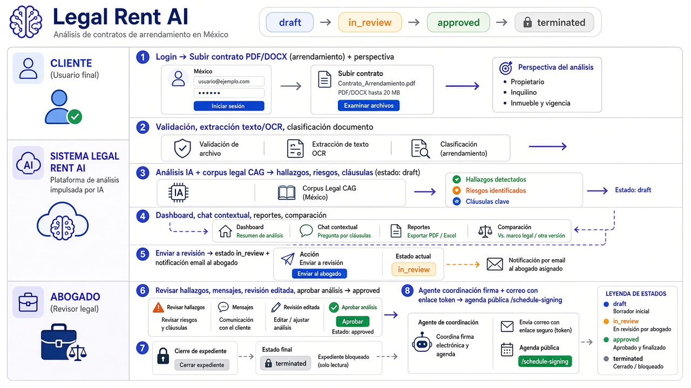

# Mexico Residential Lease Contract Analysis System — MVP

System for analyzing residential lease contracts in Mexico, with emphasis on Jalisco.

## User guide (web application)

Step-by-step manual for **client** and **lawyer** (login, contract upload, analysis, chat, review, closure, and signing):

- **PDF:** [Legal Rent AI Guide.pdf](./docs/guide/Legal%20Rent%20AI%20Guide.pdf)

Typical environments: [Docker local](#docker-local) (`http://localhost:8080`) or [Azure (LIDR)](#usage-on-azure-lidr). Use the [test accounts](#test-accounts-local-development) below.

## Client–lawyer flow (from contract upload)

End-to-end case journey: upload and AI analysis, collaboration, contract states (`draft` → `in_review` → `approved` → `terminated`), and signing coordination after closure.



Source file: [`docs/cliente-abogado-flujo-contrato.png`](./docs/cliente-abogado-flujo-contrato.png). Functional detail in [`docs/requirements.md`](./docs/requirements.md#5-main-flow-completed) and [`docs/api.md`](./docs/api.md).

## MVP features

- PDF and DOCX upload and text extraction
- OCR for scanned documents
- Structured extraction of contractual information
- Clause analysis and risk detection
- Authorized legal corpus (CAG) in prompts; vector RAG planned
- Contextual chat with the contract
- Report generation
- Email notifications to the lawyer (ACS Email / SMTP / dev mode)
- Signing coordination after case closure (agent + public schedule with token)

## Requirements

- Python 3.11+
- Azure OpenAI or compatible LLM provider
- SQL Server 2019+ (local or Azure SQL) — see [docs/database](./docs/database/README.md)

## Installation

```bash
# Create virtual environment
python -m venv venv

# Activate virtual environment
venv\Scripts\activate  # On Windows

# Install dependencies
pip install -e "."
```

## Project structure

```
├── backend/             # Python API (FastAPI) and services
│   ├── api/             # REST routes
│   ├── auth/            # Authentication (RF-01)
│   ├── services/        # Use cases
│   ├── llm/             # LLM providers, prompts, chat
│   ├── guardrails/      # Domain and injection validation
│   ├── rag/             # Legal corpus (CAG)
│   ├── storage/         # Reports and LLM traces at runtime
│   └── run_backend.py   # uvicorn startup (from backend/)
├── frontend/            # React + Vite + Material UI
├── docker/              # Dockerfiles and DB init for Compose
├── docs/                # Documentation (English); includes guide/ (user PDF)
├── evals/               # Offline LLM analysis evaluation (`python -m evals`)
├── tests/               # Tests (unit, integration, smoke, load)
├── scripts/             # Utilities; see scripts/README.md
├── fixtures/            # Sample contracts (`sample-contracts/`)
├── docker-compose.yml   # Local stack api + web + SQL Server
├── run_backend.py       # Wrapper: start backend from repo root
└── pyproject.toml       # Dependencies (`pip install -e .`)
```

### Running tests

```bash
pytest                    # full suite under tests/
pytest tests/unit         # tests without DB (where applicable)
python tests/smoke/auth_quick.py
```

## Documentation

Central index: [`docs/README.md`](./docs/README.md).

| Topic | Link |
|------|--------|
| **Web application usage** | [docs/guide/README.md](./docs/guide/README.md) · [PDF](./docs/guide/Legal%20Rent%20AI%20Guide.pdf) |
| Backend (code) | [backend/README.md](./backend/README.md) |
| Frontend | [frontend/README.md](./frontend/README.md) |
| Scripts | [scripts/README.md](./scripts/README.md) |
| REST API | [docs/api.md](./docs/api.md) |
| Docker / Azure | [docs/deployment/docker.md](./docs/deployment/docker.md) |
| Docker architecture | [docs/deployment/docker-architecture.md](./docs/deployment/docker-architecture.md) |
| AI, agents, and LiteLLM | [docs/architecture/ai-runtime-and-litellm.md](./docs/architecture/ai-runtime-and-litellm.md) |
| Database | [docs/database/README.md](./docs/database/README.md) |
| C4 architecture | [docs/architecture/README.md](./docs/architecture/README.md) |
| Requirements | [docs/requirements.md](./docs/requirements.md) |
| Authentication | [docs/authentication.md](./docs/authentication.md) |
| Contracts | [docs/contracts.md](./docs/contracts.md) |

## Language policy

| Scope | Language |
|--------|--------|
| Source code | English |
| Documentation (`docs/`, this README) | English |
| Web UI (`frontend/`) | English |
| API (messages and roles) | English |

User roles in the API use the values `lawyer` and `client`.

## Configuration

Copy `.env.example` to `.env` and set your variables:

```bash
copy .env.example .env
```

**LLM provider (LiteLLM):** default `LLM_PROVIDER=openai` with `OPENAI_API_KEY`. For Anthropic, set `LLM_PROVIDER=anthropic`, `ANTHROPIC_API_KEY`, and optionally `ANTHROPIC_MODEL` (e.g. `claude-3-5-haiku-20241022`). Analysis and chat use the same configured provider. UI chat consumes `POST /chat/sessions/{id}/messages/stream` (SSE) for real-time responses.

## Docker (local)

Three containers (`api`, `web`, `sqlserver`) + DB initialization job.

- Operations guide: [docs/deployment/docker.md](./docs/deployment/docker.md)
- **Architecture diagram** (ASCII + Mermaid; Mermaid requires GitHub/VS Code preview): [docs/deployment/docker-architecture.md](./docs/deployment/docker-architecture.md)

## AI layer (AIRuntime + LiteLLM)

Analysis, SSE chat, and the LangGraph signing coordination agent go through **`AIRuntime`** and the provider registry in `backend/llm/`, with unified abstraction in `litellm_runtime` (OpenAI / Anthropic / Azure / heuristic).

**High-level diagram** (ASCII + Mermaid): [docs/architecture/ai-runtime-and-litellm.md](./docs/architecture/ai-runtime-and-litellm.md)

On Windows, to store images and the virtual disk on **D:\Docker files** (not C:):

```powershell
.\scripts\docker\configure-docker-data-dir.ps1
# Open Docker Desktop and wait until ready
```

```powershell
copy .env.docker.example .env.docker
# Set MSSQL_SA_PASSWORD and DB_PASSWORD (same value), OPENAI_API_KEY, SECRET_KEY
# If the repo is on Dropbox (Windows): .\scripts\docker\docker-up.ps1
docker compose up --build
```

UI: http://localhost:8080 — API: http://localhost:8000/docs

## Usage on Azure (LIDR)

Deployment in resource group **`lidr`** (Container Apps + Azure SQL). The SPA calls the API via **`/api`** on the same origin (equivalent to Docker/nginx).

| Resource | URL |
|--------|-----|
| **Web app** (login, dashboard) | https://legalrent-lidr-web.ashyhill-93ea1614.eastus2.azurecontainerapps.io |
| **REST API** | https://legalrent-lidr-api.ashyhill-93ea1614.eastus2.azurecontainerapps.io |
| **Swagger** | https://legalrent-lidr-api.ashyhill-93ea1614.eastus2.azurecontainerapps.io/docs |
| **Health** | https://legalrent-lidr-api.ashyhill-93ea1614.eastus2.azurecontainerapps.io/health |

Public signing schedule (link with token from post-closure email):  
`https://legalrent-lidr-web.ashyhill-93ea1614.eastus2.azurecontainerapps.io/schedule-signing?token=…`

**Test accounts** (demo users from `docs/database/seed.sql`; same credentials as local if Azure DB was initialized with the deploy script):

| Email | Password | Role (API) |
|-------|------------|-----------|
| `abogado@contractes.com` | `abogado123` | `lawyer` |
| `code.zemoreno@gmail.com` | `cliente123` | `client` |

Recommended flow: sign in as **client**, upload and analyze a contract; then **lawyer** for review, closure, or feedback export.

Infrastructure documentation: [docs/deployment/azure-resources.md](./docs/deployment/azure-resources.md). Redeploy: `scripts/azure/deploy-lidr.ps1`.

## Start the backend

```bash
# Option 1: Use the helper script
python run_backend.py

# Option 2: Directly with uvicorn (from backend/)
cd backend
uvicorn api.app:app --reload --host 0.0.0.0 --port 8000

# Verify it works:
# http://localhost:8000/health
# http://localhost:8000/docs (Swagger UI)
```

## Start the frontend

Requirements: **Node.js 18+** and npm.

```bash
# Option 1: Windows
start_frontend.bat

# Option 2: Manual
cd frontend
npm install
npm run dev

# Open in your browser:
# http://localhost:3000
```

Frontend stack: **React 19**, **TypeScript**, **Vite**, and **Material UI (MUI)**.

To point at a different backend, create `frontend/.env.local`:

```bash
VITE_API_URL=http://localhost:8000
```

## Test accounts (local development)

Same credentials as Azure (see table above). Valid after running `setup_database.bat` or seed in Docker/Azure.

| Email | Password | Role (API) |
|-------|------------|-----------|
| `abogado@contractes.com` | `abogado123` | `lawyer` |
| `code.zemoreno@gmail.com` | `cliente123` | `client` |

## Color system

The project uses a consistent color system:

- **Primary**: Indigo (#4f46e5) — primary actions
- **Success**: Emerald (#10b981) — positive states
- **Warning**: Amber (#f59e0b) — alerts
- **Danger**: Red (#ef4444) — errors and high risk

## UI features

- Responsive design (mobile, tablet, desktop)
- Clean, professional theme with soft shadows
- Visual feedback for loading and error states
- Session persistence with localStorage
- Modern UI with subtle gradients

## API

Full documentation: [`docs/api.md`](./docs/api.md). Swagger: `http://localhost:8000/docs`.

Includes contracts, AI analysis, chat (SSE), reports, comparisons, lawyer review, notifications, case closure, and public signing schedule (`/public/signing-schedule`).

### Offline LLM analysis evaluation

```bash
python -m evals --mode regression
```

Cases and baselines in `evals/`; does not expose HTTP endpoints.
