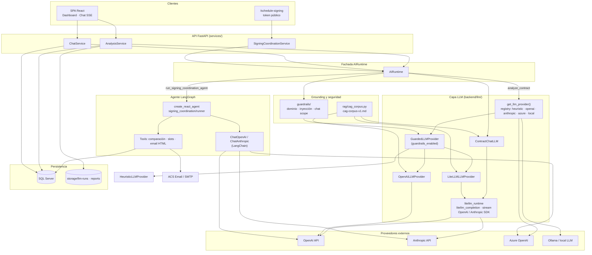

# IA, agentes y capa de abstracción (LiteLLM)

Diagrama de alto nivel de cómo el MVP usa modelos de lenguaje, el facade **`AIRuntime`** y la capa **`llm/litellm_runtime`** (abstracción multi-proveedor alineada con RF-65/RF-66, RNF-30).

Código de entrada para servicios: [`backend/ai/runtime.py`](../../backend/ai/runtime.py).

## Diagrama de alto nivel

> **Cómo ver el diagrama:** imagen PNG (abajo), **ASCII** o bloque *Mermaid* (GitHub / VS Code / [mermaid.live](https://mermaid.live)).


### Vista ASCII (siempre visible)

```
  SPA (Dashboard, Chat SSE)          /schedule-signing (público)
           │                                    │
           ▼                                    ▼
  ┌────────────────────────────────────────────────────────────┐
  │  services/  AnalysisService · ChatService · SigningCoord.   │
  └───────────────────────────┬────────────────────────────────┘
                              ▼
                    ┌─────────────────┐
                    │   AIRuntime     │  ◄── guardrails (dominio, inyección)
                    └────────┬────────┘
         ┌───────────────────┼───────────────────┐
         ▼                   ▼                   ▼
  analyze_contract      chat / stream    signing agent (LangGraph)
         │                   │                   │
         ▼                   ▼                   ▼
  get_llm_provider()   ContractChatLLM    ReAct + tools (email, slots)
         │                   │                   │
         ▼                   ▼                   │
  GuardedLLMProvider   litellm_runtime ────────┼──► OpenAI / Anthropic / Azure
  (openai · anthropic · heuristic · azure · local)     (LangChain en agente)
         │                   │
         ▼                   ▼
  + CAG corpus (cag-corpus-v1.md) inyectado en prompts
         │
         ▼
  SQL Server  ·  storage/llm-runs  ·  ACS Email / SMTP
```

### Vista Mermaid (renderizada en GitHub / VS Code)



## Responsabilidades por capa

| Capa | Módulos | Rol |
| ---- | ------- | --- |
| **Servicios** | `services/analysis_service.py`, `chat_service.py`, `signing_coordination_service.py` | Orquestación HTTP, BD, colas async; **no** llaman proveedores LLM directamente |
| **AIRuntime** | `ai/runtime.py` | Punto único: análisis, chat (sync/stream), validación de chat, agente de firma |
| **Registro LLM** | `llm/registry.py` | Factory por `LLM_PROVIDER`; opcional envoltorio `GuardedLLMProvider` |
| **LiteLLM (abstracción del repo)** | `llm/litellm_runtime.py`, `llm/litellm_provider.py` | API unificada `litellm_completion` / stream; enrutamiento OpenAI vs Anthropic; resolución de modelo (`resolve_litellm_model`) |
| **Chat** | `llm/chat_provider.py` | Prompts + CAG + JSON de respuesta; streaming SSE hacia el frontend |
| **Agente** | `agents/signing_coordination/` | LangGraph ReAct tras cierre `approved→terminated`; herramientas deterministas + LLM vía LangChain |
| **Evals offline** | `evals/` | Proveedor/juez separados (`eval_judge_*`); no pasa por AIRuntime en tráfico HTTP |

## Flujos principales

### 1. Análisis contractual

```text
POST /contracts/{id}/analyses
  → AnalysisService.run_pipeline
  → AIRuntime.analyze_contract
  → get_llm_provider() → [Guarded] OpenAI | LiteLLMLLMProvider | Heuristic | Azure | Local
  → system prompt + CAG (legal_cag_enabled)
  → persistencia: analyses, clauses, findings, analysis_llm_runs
```

### 2. Chat contextual (SSE)

```text
POST /chat/sessions/{id}/messages/stream
  → ChatService
  → AIRuntime.chat_stream
  → ContractChatLLM → litellm_completion_stream
  → observability/chat_llm_tracker (eventos en BD)
```

### 3. Coordinación de firma (agente)

```text
PATCH contract status → terminated (lawyer)
  → SigningCoordinationService
  → AIRuntime.run_signing_coordination
  → LangGraph ReAct (o fallback determinista si LLM_PROVIDER=heuristic)
  → tools: comparación almacenada, slots, send_signing_coordination_email
  → enlace FRONTEND_BASE_URL/schedule-signing?token=
```

## Proveedores (`LLM_PROVIDER`)

| Valor | Análisis | Chat | Agente de firma |
| ----- | -------- | ---- | ---------------- |
| `openai` | `OpenAILLMProvider` | `litellm_runtime` → OpenAI SDK | `ChatOpenAI` |
| `anthropic` | `LiteLLMLLMProvider` | `litellm_runtime` → Anthropic SDK | `ChatAnthropic` |
| `azure` | `AzureOpenAILLMProvider` | — | `ChatOpenAI` (Azure) |
| `local` | `LocalLLMProvider` | — | — |
| `heuristic` | Reglas sin API | — | Fallback sin LLM (tools en orden fijo) |

> **Nota:** el paquete Python `litellm` se usa de forma acotada (p. ej. estimación de coste en `observability/llm_cost.py`). La abstracción principal del producto es el módulo **`litellm_runtime`**, que unifica completions y streaming sobre los SDK oficiales.

## Variables de entorno relevantes

Ver [`.env.example`](../../.env.example): `LLM_PROVIDER`, `OPENAI_*`, `ANTHROPIC_*`, `AZURE_OPENAI_*`, `LOCAL_LLM_*`, `LEGAL_CAG_*`, `GUARDRAILS_*`, `EVAL_JUDGE_*`.

## Referencias

- [C4 — componentes](./c4-level3-components.md)
- [api.md](../api.md) — endpoints de análisis, chat y `/public/signing-schedule`
- [docker-architecture.md](../deployment/docker-architecture.md) — IA in-process en contenedor `api`
- [legal-sources/README.md](../legal-sources/README.md) — corpus CAG
