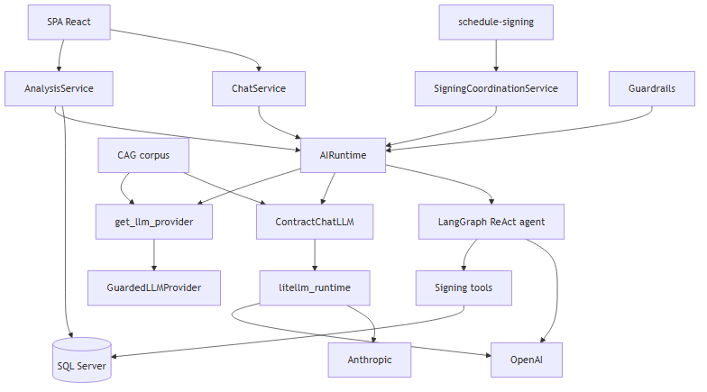

# AI, agents, and abstraction layer (LiteLLM)

High-level diagram of how the MVP uses language models, the **`AIRuntime`** facade, and the **`llm/litellm_runtime`** layer (multi-provider abstraction aligned with RF-65/RF-66, RNF-30).

Service entry code: [`backend/ai/runtime.py`](../../backend/ai/runtime.py).

## High-level diagram

> **How to view the diagram:** PNG image (below), **ASCII**, or *Mermaid* block (GitHub / VS Code / [mermaid.live](https://mermaid.live)).



### ASCII view (always visible)

```
  SPA (Dashboard, Chat SSE)          /schedule-signing (public)
           │                                    │
           ▼                                    ▼
  ┌────────────────────────────────────────────────────────────┐
  │  services/  AnalysisService · ChatService · SigningCoord.   │
  └───────────────────────────┬────────────────────────────────┘
                              ▼
                    ┌─────────────────┐
                    │   AIRuntime     │  ◄── guardrails (domain, injection)
                    └────────┬────────┘
         ┌───────────────────┼───────────────────┐
         ▼                   ▼                   ▼
  analyze_contract      chat / stream    signing agent (LangGraph)
         │                   │                   │
         ▼                   ▼                   ▼
  get_llm_provider()   ContractChatLLM    ReAct + tools (email, slots)
         │                   │                   │
         ▼                   ▼                   │
  GuardedLLMProvider   litellm_runtime ────────┼──► OpenAI / Anthropic / Azure
  (openai · anthropic · heuristic · azure · local)     (LangChain in agent)
         │                   │
         ▼                   ▼
  + CAG corpus (cag-corpus-v1.md) injected in prompts
         │
         ▼
  SQL Server  ·  storage/llm-runs  ·  ACS Email / SMTP
```

### Mermaid view (rendered on GitHub / VS Code)


## Responsibilities by layer

| Layer | Modules | Role |
| ---- | ------- | --- |
| **Services** | `services/analysis_service.py`, `chat_service.py`, `signing_coordination_service.py` | HTTP, DB, async queue orchestration; **do not** call LLM providers directly |
| **AIRuntime** | `ai/runtime.py` | Single entry: analysis, chat (sync/stream), chat validation, signing agent |
| **LLM registry** | `llm/registry.py` | Factory by `LLM_PROVIDER`; optional `GuardedLLMProvider` wrapper |
| **LiteLLM (repo abstraction)** | `llm/litellm_runtime.py`, `llm/litellm_provider.py` | Unified API `litellm_completion` / stream; OpenAI vs Anthropic routing; model resolution (`resolve_litellm_model`) |
| **Chat** | `llm/chat_provider.py` | Prompts + CAG + response JSON; SSE streaming to frontend |
| **Agent** | `agents/signing_coordination/` | LangGraph ReAct after `approved→terminated` closure; deterministic tools + LLM via LangChain |
| **Offline evals** | `evals/` | Separate provider/judge (`eval_judge_*`); does not go through AIRuntime on HTTP traffic |

## Main flows

### 1. Contract analysis

```text
POST /contracts/{id}/analyses
  → AnalysisService.run_pipeline
  → AIRuntime.analyze_contract
  → get_llm_provider() → [Guarded] OpenAI | LiteLLMLLMProvider | Heuristic | Azure | Local
  → system prompt + CAG (legal_cag_enabled)
  → persistence: analyses, clauses, findings, analysis_llm_runs
```

### 2. Contextual chat (SSE)

```text
POST /chat/sessions/{id}/messages/stream
  → ChatService
  → AIRuntime.chat_stream
  → ContractChatLLM → litellm_completion_stream
  → observability/chat_llm_tracker (events in DB)
```

### 3. Signing coordination (agent)

```text
PATCH contract status → terminated (lawyer)
  → SigningCoordinationService
  → AIRuntime.run_signing_coordination
  → LangGraph ReAct (or deterministic fallback if LLM_PROVIDER=heuristic)
  → tools: stored comparison, slots, send_signing_coordination_email
  → link FRONTEND_BASE_URL/schedule-signing?token=
```

## Providers (`LLM_PROVIDER`)

| Value | Analysis | Chat | Signing agent |
| ----- | -------- | ---- | ---------------- |
| `openai` | `OpenAILLMProvider` | `litellm_runtime` → OpenAI SDK | `ChatOpenAI` |
| `anthropic` | `LiteLLMLLMProvider` | `litellm_runtime` → Anthropic SDK | `ChatAnthropic` |
| `azure` | `AzureOpenAILLMProvider` | — | `ChatOpenAI` (Azure) |
| `local` | `LocalLLMProvider` | — | — |
| `heuristic` | Rules without API | — | Fallback without LLM (tools in fixed order) |

> **Note:** the Python `litellm` package is used in a limited way (e.g. cost estimation in `observability/llm_cost.py`). The product’s main abstraction is the **`litellm_runtime`** module, which unifies completions and streaming over the official SDKs.

## Relevant environment variables

See [`.env.example`](../../.env.example): `LLM_PROVIDER`, `OPENAI_*`, `ANTHROPIC_*`, `AZURE_OPENAI_*`, `LOCAL_LLM_*`, `LEGAL_CAG_*`, `GUARDRAILS_*`, `EVAL_JUDGE_*`.

## References

- [C4 — components](./c4-level3-components.md)
- [api.md](../api.md) — analysis, chat, and `/public/signing-schedule` endpoints
- [docker-architecture.md](../deployment/docker-architecture.md) — in-process AI in `api` container
- [legal-sources/README.md](../legal-sources/README.md) — CAG corpus
