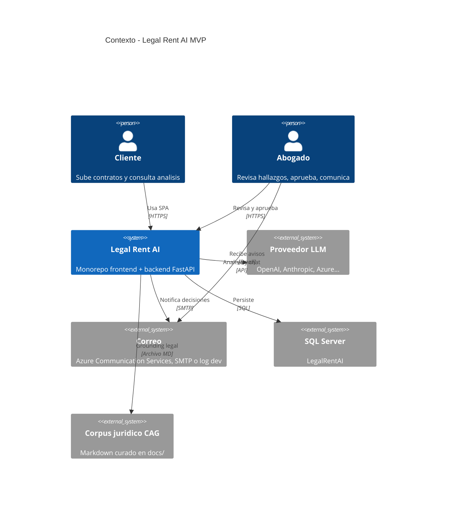

# C4 — Nivel 1: Contexto del sistema

**Legal Rent AI** asiste la primera revisión de contratos de arrendamiento inmobiliario en México (prioridad Jalisco): extracción documental, análisis con IA, corpus legal (CAG), chat, reportes y colaboración cliente–abogado.

## Diagrama

## Actores

| Actor | Rol API | Responsabilidad |
|-------|---------|-----------------|
| Cliente | `client` | Carga contratos, ejecuta análisis (perspectiva arrendatario), chat, reportes, notifica al abogado |
| Abogado | `lawyer` | Revisa hallazgos, sube revisión editada, compara versiones, aprueba análisis, cierra expediente (`terminated`), export de feedback |

> El rol `administrator` fue retirado del catálogo; operaciones de retención avanzadas quedan en servicios internos o futuros endpoints.

## Sistemas externos

| Sistema | Uso en MVP |
|---------|------------|
| Proveedor LLM | Extracción, cláusulas, riesgos, chat (LiteLLM) |
| SQL Server | Usuarios, contratos, binarios, análisis, chat, logs |
| Corpus CAG | `docs/legal-sources/cag-corpus-v1.md` — no RAG vectorial aún |
| Correo | Notificaciones RF-50/51 y coordinación de firma (ACS Email preferido; fallback SMTP / log dev) |

## Alcance

- **Dentro:** flujo arrendamiento inmobiliario MX, expediente por contrato, revisión abogado.
- **Fuera (MVP):** multi-tenant, firma electrónica legalmente vinculante, ERP, API pública general, índice vectorial de leyes completas.
- **Parcial:** agenda de firma vía enlace tokenizado (`/public/signing-schedule` + SPA `/schedule-signing`); confirmación simulada sin calendario persistente.

## Estado (septiembre 2026)

| Elemento | Estado |
|----------|--------|
| Web + API + BD | ✅ Operativo en dev |
| Análisis IA + CAG + guardrails | ✅ |
| Chat SSE | ✅ |
| Coordinación de firma (agente + email + página pública) | ✅ (simulación de slots) |
| Docker local + despliegue Azure LIDR | ✅ script `scripts/azure/deploy-lidr.ps1` |
| Evals offline LLM | ✅ `python -m evals` (no expuesto en API) |
| RAG embeddings | 📋 Planificado |
