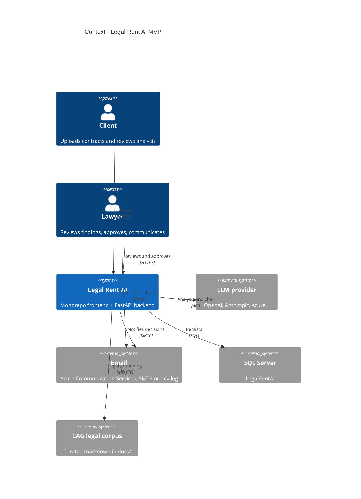

# C4 — Level 1: System context

**Legal Rent AI** supports first-pass review of real estate lease contracts in Mexico (Jalisco priority): document extraction, AI analysis, legal corpus (CAG), chat, reports, and client–lawyer collaboration.

## Diagram

## Actors

| Actor | API role | Responsibility |
|-------|---------|-----------------|
| Client | `client` | Upload contracts, run analysis (tenant perspective), chat, reports, notify lawyer |
| Lawyer | `lawyer` | Review findings, upload edited revision, compare versions, approve analysis, close case (`terminated`), feedback export |

> The `administrator` role was removed from the catalog; advanced retention operations remain in internal services or future endpoints.

## External systems

| System | MVP usage |
|---------|------------|
| LLM provider | Extraction, clauses, risks, chat (LiteLLM) |
| SQL Server | Users, contracts, binaries, analyses, chat, logs |
| CAG corpus | `docs/legal-sources/cag-corpus-v1.md` — no vector RAG yet |
| Email | RF-50/51 notifications and signing coordination (ACS Email preferred; SMTP / dev log fallback) |

## Scope

- **In scope:** MX real estate lease flow, per-contract case file, lawyer review.
- **Out of scope (MVP):** multi-tenant, legally binding e-signature, ERP, general public API, full-law vector index.
- **Partial:** signing schedule via tokenized link (`/public/signing-schedule` + SPA `/schedule-signing`); simulated confirmation without persistent calendar.

## Status (September 2026)

| Element | Status |
|----------|--------|
| Web + API + DB | ✅ Operational in dev |
| AI analysis + CAG + guardrails | ✅ |
| Chat SSE | ✅ |
| Signing coordination (agent + email + public page) | ✅ (simulated slots) |
| Local Docker + Azure LIDR deployment | ✅ script `scripts/azure/deploy-lidr.ps1` |
| Offline LLM evals | ✅ `python -m evals` (not exposed on API) |
| RAG embeddings | 📋 Planned |
