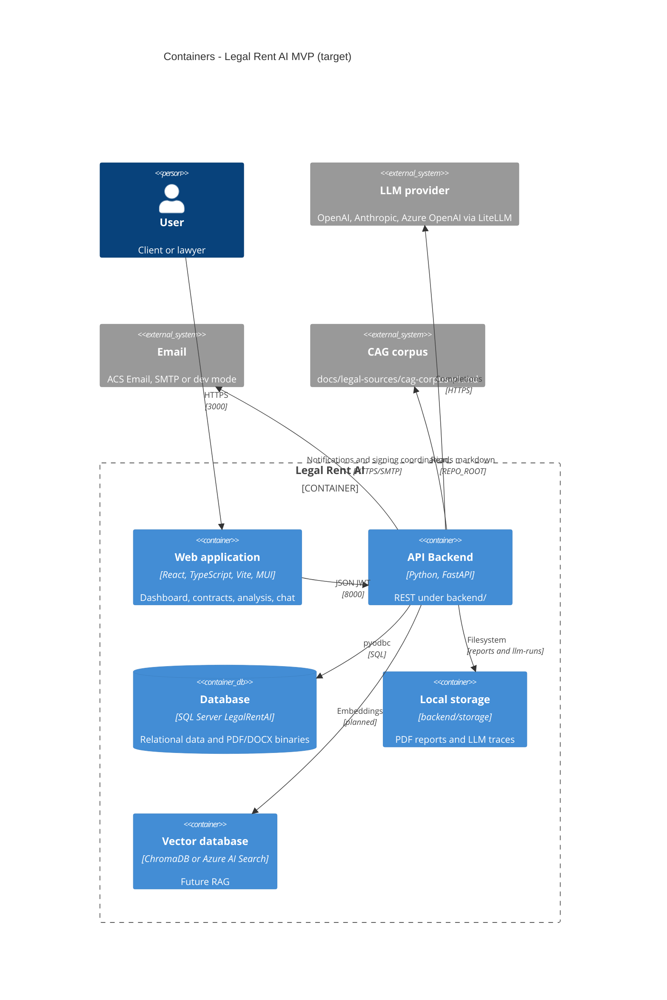

# C4 — Level 2: Containers

Deployable units: SPA, API, database, and external services.

## Diagram — MVP target view

## Diagram — Current state (September 2026)

## Container descriptions

### Web application (`frontend/`)

| Attribute | Value |
|----------|-------|
| Stack | React 19, TypeScript, Vite, Material UI |
| Dev port | 3000 (`VITE_API_URL` → backend) |
| Status | ✅ Dashboard, contracts, analysis, chat, comparisons, closure, `/schedule-signing` |

### API Backend (`backend/`)

| Attribute | Value |
|----------|-------|
| Stack | Python 3.11+, FastAPI, Uvicorn |
| Dev port | 8000 |
| Entry | `run_backend.py` (root) or `backend/run_backend.py` |
| Status | ✅ Functional MVP: see [api.md](../api.md) |

### Database

| Attribute | Value |
|----------|-------|
| Engine | SQL Server 2019+ / Azure SQL |
| Schema | `[app]`, 23 tables |
| Documents | `VARBINARY(MAX)` in row (no Blob in dev) |

### File storage

| Environment | Usage |
|---------|-----|
| Dev | Reports in `backend/storage/reports/`; contracts in SQL |
| Prod (target) | Azure Blob for high-volume artifacts |

### Legal corpus (CAG)

Curated markdown in `docs/legal-sources/cag-corpus-v1.md`, loaded by `backend/rag/cag_corpus.py` (no vector index in the current MVP).

### Vector database

📋 Planned (ChromaDB / Azure AI Search). Current legal grounding is **cache-augmented generation** with a static corpus.

## Communication

| Source | Destination | Protocol |
|--------|---------|-----------|
| SPA | API | HTTPS JSON + SSE (chat) |
| API | SQL Server | TDS / pyodbc |
| API | LLM | HTTPS (OpenAI, Anthropic, etc.) |
| API | Email | ACS Email (`AZURE_COMMUNICATION_*`) or SMTP; log if `NOTIFICATION_DEV_MODE=true` |

### Docker Compose (development)

| Container | Role |
|------------|-----|
| `api` | Image `docker/backend/Dockerfile` |
| `web` | nginx + proxy `/api` → API (SSE chat) |
| `sqlserver` + `db-init` | SQL Server 2022 + scripts in `docs/database/` |

Guide: [deployment/docker.md](../deployment/docker.md).

## Azure deployment (LIDR)

Implemented via **`scripts/azure/deploy-lidr.ps1`**: ACR, Azure SQL, Container Apps (`legalrent-lidr-api`, `legalrent-lidr-web`). Resources and ACS tests: [deployment/azure-resources.md](../deployment/azure-resources.md).

Extended target: Key Vault for secrets, dedicated Azure OpenAI, Blob for high-volume artifacts.
