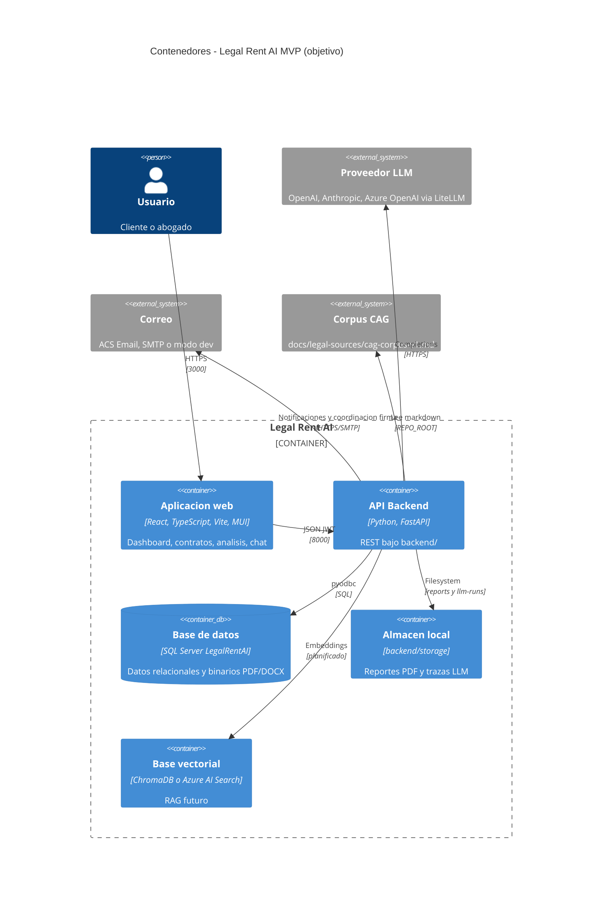
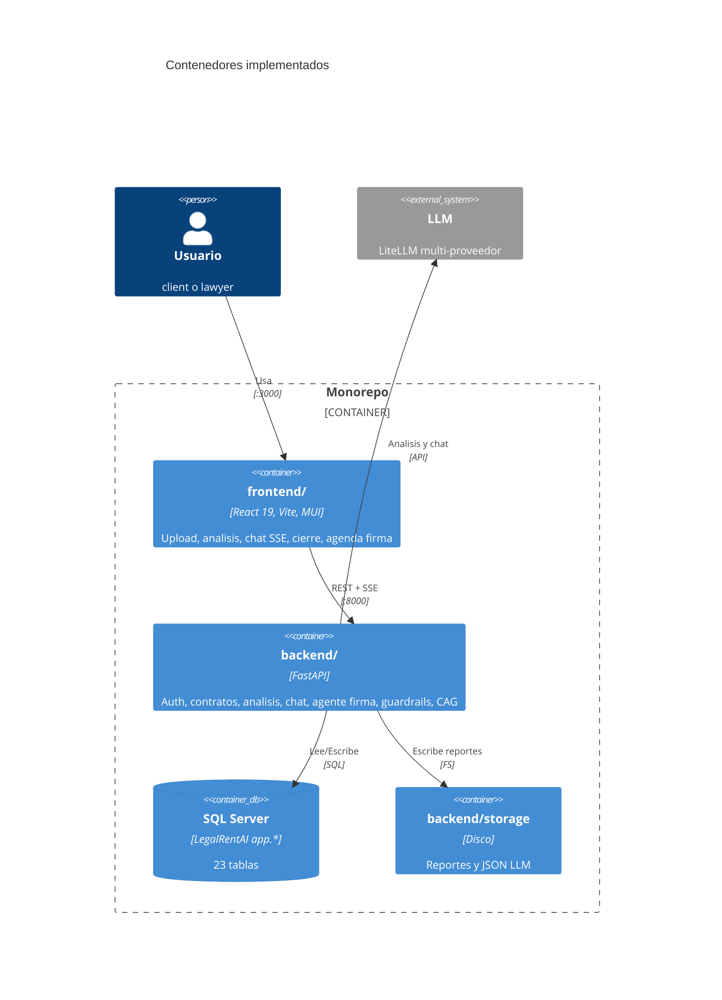

# C4 — Nivel 2: Contenedores

Unidades desplegables: SPA, API, base de datos y servicios externos.

## Diagrama — Vista objetivo MVP

## Diagrama — Estado actual (septiembre 2026)

## Descripción de contenedores

### Aplicación web (`frontend/`)

| Atributo | Valor |
|----------|-------|
| Stack | React 19, TypeScript, Vite, Material UI |
| Puerto dev | 3000 (`VITE_API_URL` → backend) |
| Estado | ✅ Dashboard, contratos, análisis, chat, comparaciones, cierre, `/schedule-signing` |

### API Backend (`backend/`)

| Atributo | Valor |
|----------|-------|
| Stack | Python 3.11+, FastAPI, Uvicorn |
| Puerto dev | 8000 |
| Entrada | `run_backend.py` (raíz) o `backend/run_backend.py` |
| Estado | ✅ MVP funcional: ver [api.md](../api.md) |

### Base de datos

| Atributo | Valor |
|----------|-------|
| Motor | SQL Server 2019+ / Azure SQL |
| Esquema | `[app]`, 23 tablas |
| Documentos | `VARBINARY(MAX)` en fila (no Blob en dev) |

### Almacenamiento de archivos

| Entorno | Uso |
|---------|-----|
| Dev | Reportes en `backend/storage/reports/`; contratos en SQL |
| Prod (objetivo) | Azure Blob para artefactos de gran volumen |

### Corpus jurídico (CAG)

Markdown curado en `docs/legal-sources/cag-corpus-v1.md`, cargado por `backend/rag/cag_corpus.py` (sin índice vectorial en el MVP actual).

### Base vectorial

📋 Planificado (ChromaDB / Azure AI Search). El grounding legal actual es **cache-augmented generation** con corpus estático.

## Comunicación

| Origen | Destino | Protocolo |
|--------|---------|-----------|
| SPA | API | HTTPS JSON + SSE (chat) |
| API | SQL Server | TDS / pyodbc |
| API | LLM | HTTPS (OpenAI, Anthropic, etc.) |
| API | Correo | ACS Email (`AZURE_COMMUNICATION_*`) o SMTP; log si `NOTIFICATION_DEV_MODE=true` |

### Docker Compose (desarrollo)

| Contenedor | Rol |
|------------|-----|
| `api` | Imagen `docker/backend/Dockerfile` |
| `web` | nginx + proxy `/api` → API (SSE chat) |
| `sqlserver` + `db-init` | SQL Server 2022 + scripts en `docs/database/` |

Guía: [deployment/docker.md](../deployment/docker.md).

## Despliegue Azure (LIDR)

Implementado vía **`scripts/azure/deploy-lidr.ps1`**: ACR, Azure SQL, Container Apps (`legalrent-lidr-api`, `legalrent-lidr-web`). Recursos y pruebas ACS: [deployment/azure-resources.md](../deployment/azure-resources.md).

Objetivo ampliado: Key Vault para secretos, Azure OpenAI dedicado, Blob para artefactos voluminosos.
