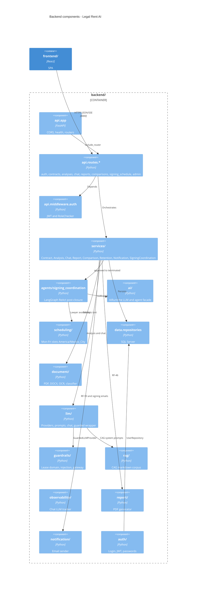
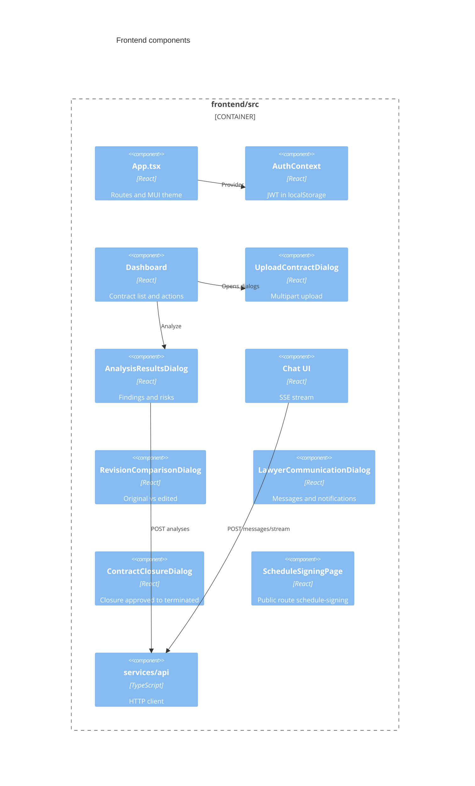
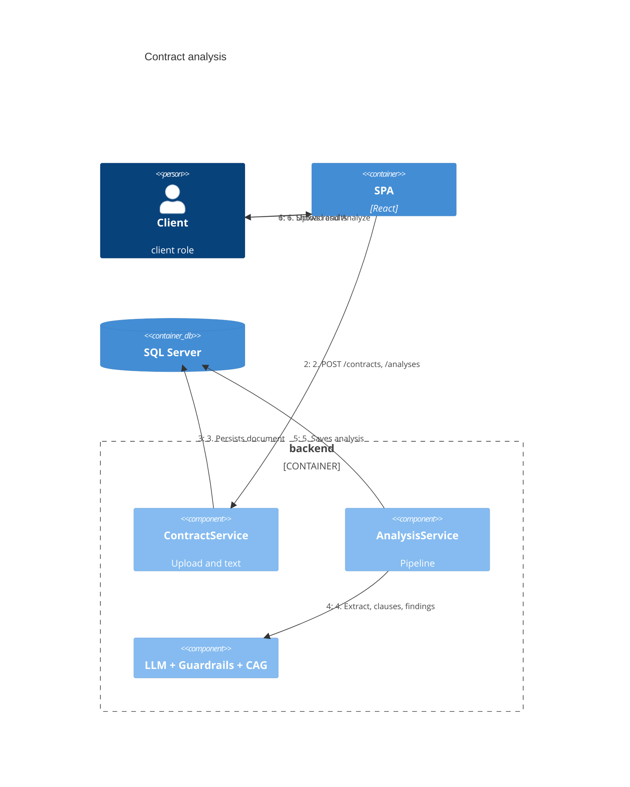

# C4 — Level 3: Components

Logical modules within the **backend** (`backend/`) and **SPA** (`frontend/src/`).

## Backend — FastAPI components



## Frontend — React components



## Folder → responsibility map

| Folder (`backend/`) | Status | Notes |
|----------------------|--------|--------|
| `api/` | ✅ | Routes mounted in `create_router()` |
| `auth/` | ✅ | Roles `lawyer`, `client` |
| `services/` | ✅ | Main use cases |
| `data/` | ✅ | pyodbc repositories |
| `domain/` | ✅ | Enums and entities |
| `document/` | ✅ | Extraction and classification |
| `llm/` | ✅ | Multi-provider + chat |
| `guardrails/` | ✅ | Gateway before LLM |
| `rag/` | ✅ | CAG (no vector DB) |
| `observability/` | ✅ | Chat events → DB |
| `report/` | ✅ | PDF/JSON |
| `notification/` | ✅ | ACS Email, SMTP, dev log |
| `agents/signing_coordination/` | ✅ | Post-`terminated` agent |
| `scheduling/` | ✅ | Simulated slots |
| `ai/` | ✅ | Single facade for services |
| `analysis/` | 🚧 | Reserved package; logic in `services/analysis_service.py` |
| `frontend/src/components/contracts/` | ✅ | MVP flows + closure |
| `frontend/src/components/signing/` | ✅ | Public schedule with token |
| `evals/` (repo root) | ✅ | Offline regression/judge (`python -m evals`) |

## Analysis flow (implemented)



## Layer dependencies

```
api/routes  →  services/  →  domain/
                 ↓
    document/ | llm/ | guardrails/ | rag/ | report/ | notification/
                 ↓
              data/repositories  →  SQL Server
```

`domain/` does not import infrastructure. Configuration: `backend/config/settings.py` (`REPO_ROOT`, `BACKEND_ROOT`).
