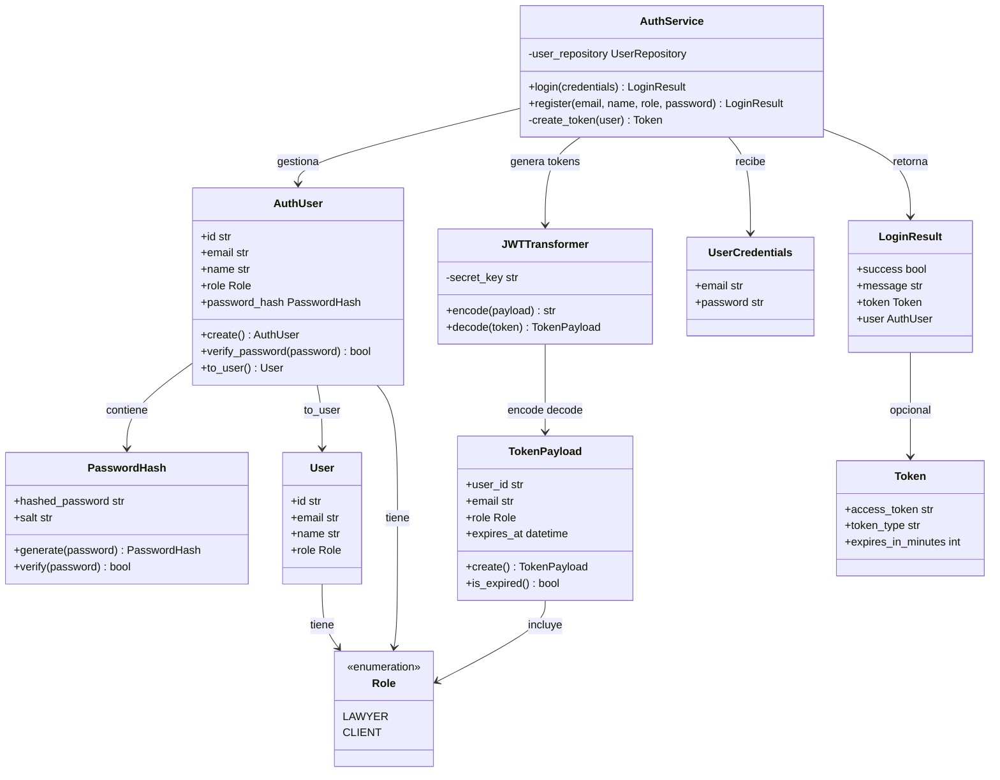
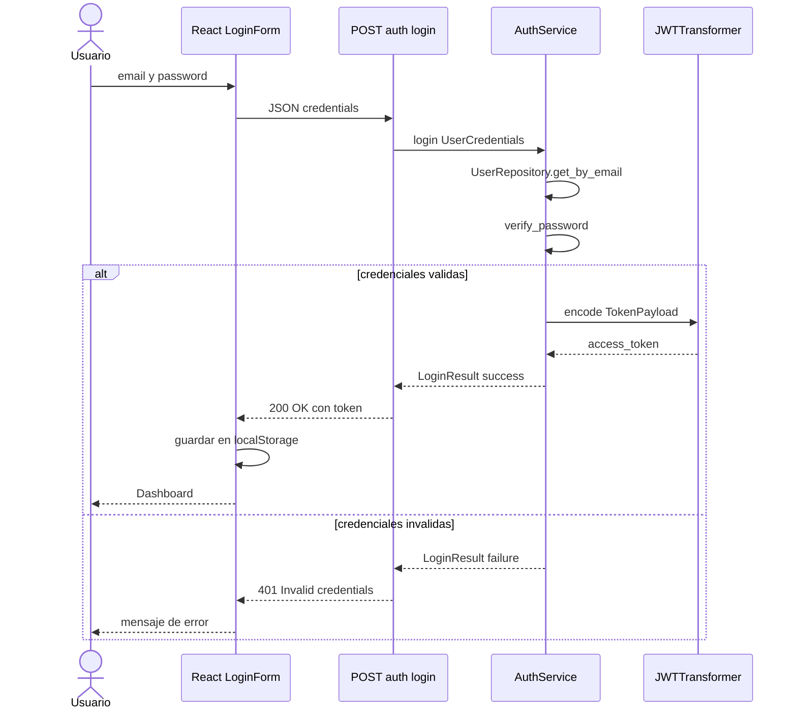

# C4 — Nivel 4: Código (módulo de autenticación)

El **nivel 4** detalla clases a nivel de código. Este documento cubre **`backend/auth/`** (JWT, login, registro). Otros módulos críticos (`services/`, `llm/`) se describen en el [nivel 3](./c4-level3-components.md).

## Diagrama de clases — `backend/auth/`

## Diagrama de secuencia — Login

## Diagrama de secuencia — Request autenticado

## Archivos del módulo

| Archivo | Responsabilidad |
|---------|-----------------|
| `auth/service.py` | Lógica de login y registro vía `UserRepository` |
| `auth/models.py` | `AuthUser`, `PasswordHash`, `Token`, `TokenPayload`, `LoginResult` |
| `auth/token.py` | `JWTTransformer` — encode/decode HS256 |
| `data/repositories/user_repository.py` | Persistencia de usuarios en SQL Server |
| `api/routes/auth.py` | Endpoints REST |
| `api/middleware/auth.py` | `RoleChecker`, decoradores por rol |
| `auth/signing_schedule_token.py` | JWT de agenda de firma (query `token`, sin exp de sesión) |

Ver también módulo de contratos: [contracts.md](../contracts.md).

## Notas de implementación

- **Hashing**: PBKDF2-HMAC-SHA256, 100 000 iteraciones, salt aleatorio.
- **JWT**: HS256, expiración configurable (default 60 min).
- **Roles**: valores en inglés (`lawyer`, `client`).
- **Persistencia**: usuarios en `app.users` vía `UserRepository` (pyodbc). Contratos y documentos: ver [contracts.md](../contracts.md).

## Próximos diagramas de código (planificado)

| Módulo | Clases clave |
|--------|--------------|
| `document/` | `validate_upload` — PDF/DOCX, 25 MB ✅ |
| `analysis/` | `ClauseAnalyzer`, `RiskClassifier` |
| `llm/` | `LLMProvider`, `AzureOpenAIProvider` |
| `rag/` | `LegalCorpusRetriever`, `EmbeddingService` |
