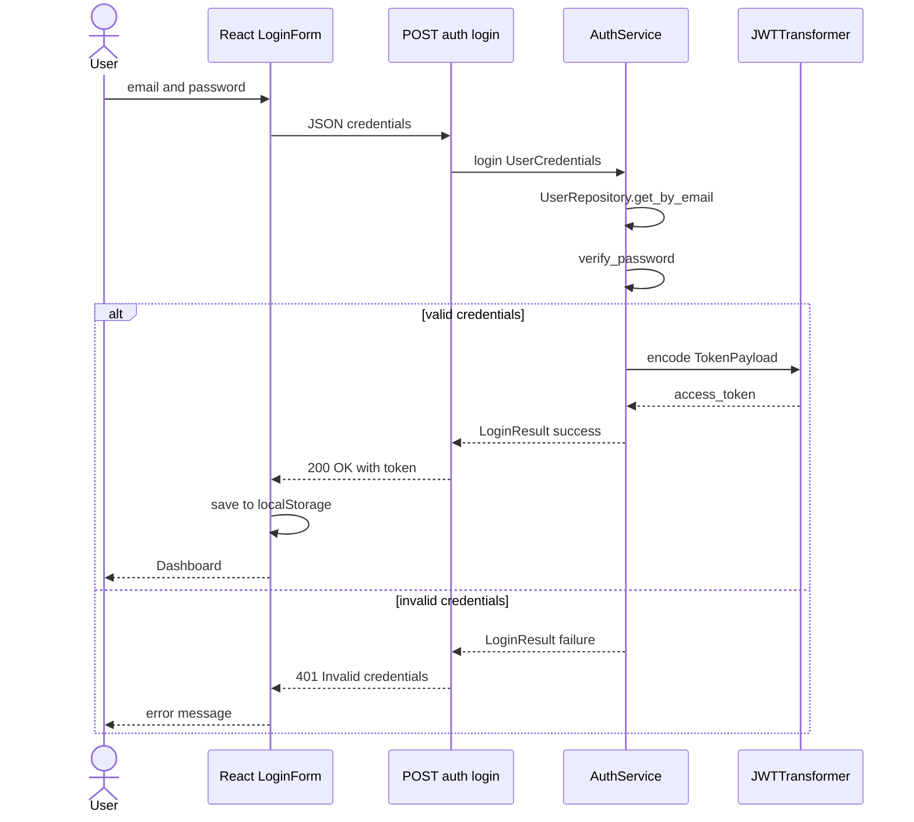
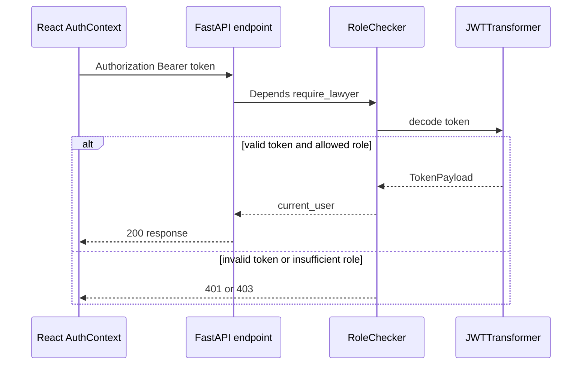

# C4 — Level 4: Code (authentication module)

**Level 4** details classes at code level. This document covers **`backend/auth/`** (JWT, login, registration). Other critical modules (`services/`, `llm/`) are described at [level 3](./c4-level3-components.md).

## Class diagram — `backend/auth/`

## Sequence diagram — Login

## Sequence diagram — Authenticated request

## Module files

| File | Responsibility |
|---------|-----------------|
| `auth/service.py` | Login and registration logic via `UserRepository` |
| `auth/models.py` | `AuthUser`, `PasswordHash`, `Token`, `TokenPayload`, `LoginResult` |
| `auth/token.py` | `JWTTransformer` — encode/decode HS256 |
| `data/repositories/user_repository.py` | User persistence in SQL Server |
| `api/routes/auth.py` | REST endpoints |
| `api/middleware/auth.py` | `RoleChecker`, role decorators |
| `auth/signing_schedule_token.py` | Signing schedule JWT (query `token`, not session exp) |

See also contracts module: [contracts.md](../contracts.md).

## Implementation notes

- **Hashing**: PBKDF2-HMAC-SHA256, 100,000 iterations, random salt.
- **JWT**: HS256, configurable expiration (default 60 min).
- **Roles**: English values (`lawyer`, `client`).
- **Persistence**: users in `app.users` via `UserRepository` (pyodbc). Contracts and documents: see [contracts.md](../contracts.md).

## Planned code diagrams

| Module | Key classes |
|--------|--------------|
| `document/` | `validate_upload` — PDF/DOCX, 25 MB ✅ |
| `analysis/` | `ClauseAnalyzer`, `RiskClassifier` |
| `llm/` | `LLMProvider`, `AzureOpenAIProvider` |
| `rag/` | `LegalCorpusRetriever`, `EmbeddingService` |
