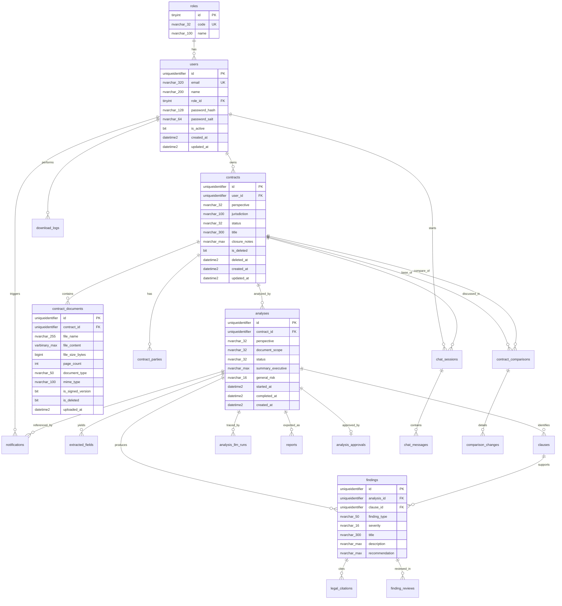

# Diseño del esquema relacional — SQL Server

Modelo de datos para **Legal Rent AI** (MVP). Cubre usuarios, contratos, documentos, análisis, hallazgos, chat, reportes, notificaciones y auditoría básica.

> **Esquema canónico:** [`ddl.sql`](./ddl.sql) (**23 tablas** en `[app]`, incluye `chat_llm_call_events`). Bases creadas antes de septiembre 2026 deben ejecutar [`migrations/run-all-incremental.sql`](./migrations/run-all-incremental.sql) y, si aplica, [`migrations/12-migrate-remove-administrator.sql`](./migrations/12-migrate-remove-administrator.sql). Verificación: `python scripts/db/verify_database_schema.py` (desde la raíz del repo).

## Diagrama entidad-relación



## Convenciones de diseño

### Identificadores y tipos

| Convención | Detalle |
|------------|---------|
| Claves primarias | `UNIQUEIDENTIFIER NOT NULL DEFAULT NEWSEQUENTIALID()` |
| Fechas | `DATETIME2(3)` en UTC |
| Texto corto | `NVARCHAR(n)` |
| Texto largo | `NVARCHAR(MAX)` |
| JSON auxiliar | `NVARCHAR(MAX)` con `ISJSON()` en aplicación |
| Montos | `DECIMAL(18,2)` donde aplique en campos extraídos |

### Nomenclatura

- **Tablas y columnas:** inglés, `snake_case` (ej. `contract_documents`, `created_at`).
- **Valores de dominio legal:** español en `extracted_fields.field_name` (ej. `arrendador`, `renta_mensual`).
- **Enums de aplicación:** almacenados como `NVARCHAR` con `CHECK` o tabla catálogo.

### Soft delete (RF-53)

Los contratos y documentos **no se eliminan físicamente** desde la UI del MVP:

- `contracts.is_deleted`, `contracts.deleted_at`
- `contract_documents.is_deleted`

Las consultas de negocio deben filtrar `is_deleted = 0`.

---

## Tablas catálogo

### `roles`

Roles del sistema (RF-02).

| Columna | Tipo | Descripción |
|---------|------|-------------|
| `id` | `TINYINT` PK | Identificador |
| `code` | `NVARCHAR(32)` UK | `lawyer`, `client` |
| `name` | `NVARCHAR(100)` | Nombre para UI |

Valores iniciales (MVP actual; tras `12-migrate-remove-administrator.sql`):

| id | code | name |
|----|------|------|
| 1 | `lawyer` | Lawyer |
| 2 | `client` | Client |

---

## Autenticación y usuarios

### `users`

Usuarios autenticados (RF-01, RF-02).

| Columna | Tipo | Nulo | Descripción |
|---------|------|------|-------------|
| `id` | `UNIQUEIDENTIFIER` | NO | PK |
| `email` | `NVARCHAR(320)` | NO | UK, login |
| `name` | `NVARCHAR(200)` | NO | Nombre visible |
| `role_id` | `TINYINT` | NO | FK → `roles.id` |
| `password_hash` | `NVARCHAR(128)` | NO | PBKDF2-HMAC-SHA256 hex |
| `password_salt` | `NVARCHAR(64)` | NO | Salt hex |
| `is_active` | `BIT` | NO | Default 1 |
| `created_at` | `DATETIME2(3)` | NO | Alta |
| `updated_at` | `DATETIME2(3)` | NO | Última modificación |

**Índices:** `UX_users_email`, `IX_users_role_id`.

---

## Contratos y documentos

### `contracts`

Contrato de arrendamiento analizado (RF-52, RF-56).

| Columna | Tipo | Nulo | Descripción |
|---------|------|------|-------------|
| `id` | `UNIQUEIDENTIFIER` | NO | PK |
| `user_id` | `UNIQUEIDENTIFIER` | NO | FK → `users.id` (propietario) |
| `perspective` | `NVARCHAR(32)` | NO | `landlord`, `tenant`, `neutral` (RF-09) |
| `jurisdiction` | `NVARCHAR(100)` | SÍ | Ej. `Jalisco`, `Ciudad de México` (RF-10) |
| `status` | `NVARCHAR(32)` | NO | Ver estados abajo |
| `title` | `NVARCHAR(300)` | SÍ | Título descriptivo opcional |
| `closure_notes` | `NVARCHAR(MAX)` | SÍ | Notas de cierre administrativo (RF-56, abogado al pasar a `terminated`) |
| `is_deleted` | `BIT` | NO | Soft delete (RF-53) |
| `deleted_at` | `DATETIME2(3)` | SÍ | Fecha de baja lógica |
| `created_at` | `DATETIME2(3)` | NO | |
| `updated_at` | `DATETIME2(3)` | NO | |

**Estados (`status`):** `draft`, `in_review`, `approved`, `in_signing`, `signed`, `expired`, `terminated`.

Flujo activo en UI/API: `draft` → `in_review` → `approved` → `terminated`. Solo `terminated` bloquea modificaciones (`LOCKED_STATUSES` en `backend/domain/contract_status.py`). El abogado no lista contratos en `draft`.

**Índices:** `IX_contracts_user_id`, `IX_contracts_status`, `IX_contracts_created_at`.

### `contract_documents`

Archivos PDF/DOCX asociados (RF-03, RF-05, RF-08, RF-57).

| Columna | Tipo | Nulo | Descripción |
|---------|------|------|-------------|
| `id` | `UNIQUEIDENTIFIER` | NO | PK |
| `contract_id` | `UNIQUEIDENTIFIER` | NO | FK → `contracts.id` |
| `file_name` | `NVARCHAR(255)` | NO | Nombre original del archivo |
| `file_content` | `VARBINARY(MAX)` | NO | Contenido binario del PDF/DOCX |
| `file_size_bytes` | `BIGINT` | NO | Tamaño en bytes (máx. 25 MB, RF-04) |
| `page_count` | `INT` | SÍ | Páginas detectadas |
| `document_type` | `NVARCHAR(50)` | NO | `main_contract`, `annex`, `other`, `lawyer_revision` |
| `mime_type` | `NVARCHAR(100)` | SÍ | `application/pdf`, etc. |
| `is_signed_version` | `BIT` | NO | Versión firmada (RF-57) |
| `is_deleted` | `BIT` | NO | Soft delete |
| `uploaded_at` | `DATETIME2(3)` | NO | |

**Índices:** `IX_contract_documents_contract_id`.

### `contract_parties`

Partes identificadas en el contrato (RF-12).

| Columna | Tipo | Nulo | Descripción |
|---------|------|------|-------------|
| `id` | `UNIQUEIDENTIFIER` | NO | PK |
| `contract_id` | `UNIQUEIDENTIFIER` | NO | FK → `contracts.id` |
| `party_type` | `NVARCHAR(50)` | NO | `landlord`, `tenant`, `guarantor`, etc. |
| `name` | `NVARCHAR(300)` | SÍ | Nombre o razón social |
| `legal_representative` | `NVARCHAR(300)` | SÍ | Representante |
| `address` | `NVARCHAR(500)` | SÍ | Domicilio |
| `confidence` | `DECIMAL(5,4)` | SÍ | Confianza de extracción |
| `source_page` | `INT` | SÍ | Página de evidencia |

---

## Análisis

### `analyses`

Ejecución de análisis sobre un contrato (RF-52, RF-58).

| Columna | Tipo | Nulo | Descripción |
|---------|------|------|-------------|
| `id` | `UNIQUEIDENTIFIER` | NO | PK |
| `contract_id` | `UNIQUEIDENTIFIER` | NO | FK → `contracts.id` |
| `status` | `NVARCHAR(32)` | NO | Ver estados abajo |
| `summary_executive` | `NVARCHAR(MAX)` | SÍ | Resumen ejecutivo (RF-37) |
| `general_risk` | `NVARCHAR(16)` | SÍ | `low`, `medium`, `high` |
| `started_at` | `DATETIME2(3)` | SÍ | Inicio de procesamiento |
| `completed_at` | `DATETIME2(3)` | SÍ | Fin (objetivo ≤ 60 s, RNF-05) |
| `created_at` | `DATETIME2(3)` | NO | |

**Estados (`status`):** `ai_generated`, `pending_review`, `reviewed`, `approved`.

**Índices:** `IX_analyses_contract_id`, `IX_analyses_status`, `IX_analyses_created_at`.

### `analysis_llm_runs`

Trazabilidad técnica de IA (RF-64, RNF-48).

| Columna | Tipo | Nulo | Descripción |
|---------|------|------|-------------|
| `id` | `UNIQUEIDENTIFIER` | NO | PK |
| `analysis_id` | `UNIQUEIDENTIFIER` | NO | FK → `analyses.id` |
| `provider` | `NVARCHAR(100)` | NO | Ej. `azure_openai` |
| `model` | `NVARCHAR(100)` | NO | Ej. `gpt-4o` |
| `model_version` | `NVARCHAR(50)` | SÍ | Versión |
| `prompt_id` | `NVARCHAR(100)` | SÍ | Identificador de prompt |
| `response_storage_path` | `NVARCHAR(500)` | SÍ | Respuesta cruda en blob |
| `tokens_input` | `INT` | SÍ | Tokens de entrada |
| `tokens_output` | `INT` | SÍ | Tokens de salida |
| `duration_ms` | `INT` | SÍ | Duración |
| `created_at` | `DATETIME2(3)` | NO | |

### `extracted_fields`

Campos estructurados extraídos (RF-11–RF-17, RNF-46).

| Columna | Tipo | Nulo | Descripción |
|---------|------|------|-------------|
| `id` | `UNIQUEIDENTIFIER` | NO | PK |
| `analysis_id` | `UNIQUEIDENTIFIER` | NO | FK → `analyses.id` |
| `field_name` | `NVARCHAR(100)` | NO | Nombre legal en español |
| `field_value` | `NVARCHAR(MAX)` | SÍ | Valor serializado |
| `confidence` | `DECIMAL(5,4)` | NO | 0.0000–1.0000 |
| `source_page` | `INT` | SÍ | Página |
| `source_clause` | `NVARCHAR(200)` | SÍ | Cláusula |
| `source_section` | `NVARCHAR(200)` | SÍ | Sección |
| `source_text_snippet` | `NVARCHAR(MAX)` | SÍ | Fragmento de evidencia |

**Campos esperados (`field_name`):** `arrendador`, `arrendatario`, `fiador`, `obligado_solidario`, `inmueble_direccion`, `inmueble_uso`, `inmueble_superficie`, `renta_mensual`, `deposito`, `garantia`, `fecha_inicio`, `fecha_fin`, `duracion_meses`, `jurisdiccion`.

**Índices:** `IX_extracted_fields_analysis_id`, `IX_extracted_fields_field_name`.

### `clauses`

Cláusulas identificadas (RF-18–RF-21).

| Columna | Tipo | Nulo | Descripción |
|---------|------|------|-------------|
| `id` | `UNIQUEIDENTIFIER` | NO | PK |
| `analysis_id` | `UNIQUEIDENTIFIER` | NO | FK → `analyses.id` |
| `category` | `NVARCHAR(100)` | NO | Categoría de cláusula |
| `text` | `NVARCHAR(MAX)` | NO | Texto de la cláusula |
| `section` | `NVARCHAR(200)` | SÍ | Sección del documento |
| `page` | `INT` | SÍ | Página |
| `confidence` | `DECIMAL(5,4)` | NO | Confianza |

### `findings`

Hallazgos y riesgos (RF-22–RF-28).

| Columna | Tipo | Nulo | Descripción |
|---------|------|------|-------------|
| `id` | `UNIQUEIDENTIFIER` | NO | PK |
| `analysis_id` | `UNIQUEIDENTIFIER` | NO | FK → `analyses.id` |
| `clause_id` | `UNIQUEIDENTIFIER` | SÍ | FK → `clauses.id` |
| `finding_type` | `NVARCHAR(50)` | NO | Tipo de hallazgo |
| `severity` | `NVARCHAR(16)` | NO | `low`, `medium`, `high` |
| `title` | `NVARCHAR(300)` | NO | Título |
| `description` | `NVARCHAR(MAX)` | NO | Descripción |
| `legal_basis` | `NVARCHAR(MAX)` | SÍ | Fundamento |
| `source_law` | `NVARCHAR(500)` | SÍ | Ley o código |
| `evidence_text` | `NVARCHAR(MAX)` | SÍ | Texto de evidencia |
| `evidence_page` | `INT` | SÍ | Página |
| `recommendation` | `NVARCHAR(MAX)` | SÍ | Recomendación |
| `suggested_rewording` | `NVARCHAR(MAX)` | SÍ | Redacción sugerida |
| `sort_order` | `INT` | NO | Orden por criticidad (RNF-41) |

**Índices:** `IX_findings_analysis_id`, `IX_findings_severity`.

### `legal_citations`

Referencias jurídicas por hallazgo (RNF-47).

| Columna | Tipo | Nulo | Descripción |
|---------|------|------|-------------|
| `id` | `UNIQUEIDENTIFIER` | NO | PK |
| `finding_id` | `UNIQUEIDENTIFIER` | NO | FK → `findings.id` |
| `law_code` | `NVARCHAR(100)` | NO | Ej. Código Civil Jalisco |
| `article` | `NVARCHAR(100)` | SÍ | Artículo |
| `excerpt` | `NVARCHAR(MAX)` | SÍ | Fragmento citado |
| `source_uri` | `NVARCHAR(500)` | SÍ | URI del corpus RAG |

---

## Chat contextual

### `chat_sessions` (RF-41)

| Columna | Tipo | Descripción |
|---------|------|-------------|
| `id` | `UNIQUEIDENTIFIER` | PK |
| `contract_id` | `UNIQUEIDENTIFIER` | FK → `contracts.id` |
| `user_id` | `UNIQUEIDENTIFIER` | FK → `users.id` |
| `analysis_id` | `UNIQUEIDENTIFIER` | FK → `analyses.id` (contexto) |
| `created_at` | `DATETIME2(3)` | Inicio de sesión |

### `chat_messages` (RF-42, RF-43)

| Columna | Tipo | Descripción |
|---------|------|-------------|
| `id` | `UNIQUEIDENTIFIER` | PK |
| `session_id` | `UNIQUEIDENTIFIER` | FK → `chat_sessions.id` |
| `role` | `NVARCHAR(20)` | `user`, `assistant`, `system` |
| `content` | `NVARCHAR(MAX)` | Mensaje |
| `references_json` | `NVARCHAR(MAX)` | Fuentes citadas (JSON) |
| `created_at` | `DATETIME2(3)` | |

---

## Reportes y descargas

### `reports` (RF-46–RF-49)

| Columna | Tipo | Descripción |
|---------|------|-------------|
| `id` | `UNIQUEIDENTIFIER` | PK |
| `analysis_id` | `UNIQUEIDENTIFIER` | FK → `analyses.id` |
| `format` | `NVARCHAR(20)` | `pdf`, `json` |
| `storage_path` | `NVARCHAR(500)` | Ruta del archivo generado |
| `generated_by` | `UNIQUEIDENTIFIER` | FK → `users.id` |
| `generated_at` | `DATETIME2(3)` | |

### `download_logs` (RF-55, RNF-49)

| Columna | Tipo | Descripción |
|---------|------|-------------|
| `id` | `UNIQUEIDENTIFIER` | PK |
| `user_id` | `UNIQUEIDENTIFIER` | FK → `users.id` |
| `resource_type` | `NVARCHAR(50)` | `contract`, `report`, `document` |
| `resource_id` | `UNIQUEIDENTIFIER` | ID del recurso |
| `downloaded_at` | `DATETIME2(3)` | |

---

## Notificaciones

### `notifications` (RF-50, RF-51)

| Columna | Tipo | Descripción |
|---------|------|-------------|
| `id` | `UNIQUEIDENTIFIER` | PK |
| `analysis_id` | `UNIQUEIDENTIFIER` | FK → `analyses.id` |
| `user_id` | `UNIQUEIDENTIFIER` | FK → `users.id` (cliente) |
| `lawyer_email` | `NVARCHAR(320)` | Destinatario |
| `decision` | `NVARCHAR(MAX)` | Decisión del usuario |
| `status` | `NVARCHAR(32)` | `pending`, `sent`, `failed` |
| `sent_at` | `DATETIME2(3)` | Envío efectivo |
| `created_at` | `DATETIME2(3)` | |

---

## Comparación de contratos (P1)

### `contract_comparisons` (RF-59)

| Columna | Tipo | Descripción |
|---------|------|-------------|
| `id` | `UNIQUEIDENTIFIER` | PK |
| `base_contract_id` | `UNIQUEIDENTIFIER` | FK → `contracts.id` |
| `compare_contract_id` | `UNIQUEIDENTIFIER` | FK → `contracts.id` |
| `created_by` | `UNIQUEIDENTIFIER` | FK → `users.id` |
| `summary` | `NVARCHAR(MAX)` | Resumen de diferencias |
| `risk_delta` | `NVARCHAR(16)` | Variación de riesgo (RF-62) |
| `created_at` | `DATETIME2(3)` | |

### `comparison_changes` (RF-60, RF-61)

| Columna | Tipo | Descripción |
|---------|------|-------------|
| `id` | `UNIQUEIDENTIFIER` | PK |
| `comparison_id` | `UNIQUEIDENTIFIER` | FK → `contract_comparisons.id` |
| `change_type` | `NVARCHAR(50)` | `added`, `removed`, `modified` |
| `category` | `NVARCHAR(100)` | Cláusula o campo afectado |
| `description` | `NVARCHAR(MAX)` | Detalle del cambio |
| `old_value` | `NVARCHAR(MAX)` | Valor anterior |
| `new_value` | `NVARCHAR(MAX)` | Valor nuevo |

---

## Human-in-the-loop (P2)

### `finding_reviews` (RF-68)

| Columna | Tipo | Descripción |
|---------|------|-------------|
| `id` | `UNIQUEIDENTIFIER` | PK |
| `finding_id` | `UNIQUEIDENTIFIER` | FK → `findings.id` |
| `lawyer_id` | `UNIQUEIDENTIFIER` | FK → `users.id` |
| `verdict` | `NVARCHAR(32)` | `correct`, `incorrect`, `not_relevant` |
| `notes` | `NVARCHAR(MAX)` | Comentarios |
| `created_at` | `DATETIME2(3)` | |

### `analysis_approvals` (RF-69)

| Columna | Tipo | Descripción |
|---------|------|-------------|
| `id` | `UNIQUEIDENTIFIER` | PK |
| `analysis_id` | `UNIQUEIDENTIFIER` | FK → `analyses.id` UK |
| `lawyer_id` | `UNIQUEIDENTIFIER` | FK → `users.id` |
| `approved_at` | `DATETIME2(3)` | |
| `notes` | `NVARCHAR(MAX)` | |

---

## Relaciones principales

```
users 1──* contracts
contracts 1──* contract_documents
contracts 1──* contract_parties
contracts 1──* analyses
analyses 1──* extracted_fields
analyses 1──* clauses
analyses 1──* findings
analyses 1──* analysis_llm_runs
findings 1──* legal_citations
findings 0..1──* finding_reviews
```

---

## Seguridad y acceso

| Requerimiento | Implementación |
|---------------|----------------|
| RNF-19 | Documentos almacenados en BD como `VARBINARY(MAX)` (`file_content`) |
| RNF-21 | URLs de descarga temporales vía API, no en BD |
| RF-53 | Soft delete en `contracts` y `contract_documents` |
| RF-54 | Política de retención + `SOFT_DELETE_RETENTION_DAYS` |
| RF-02 | `users.role_id` + lógica en API |

---

## Requerimientos cubiertos

| ID | Cobertura en BD |
|----|----------------|
| RF-01, RF-02 | `users`, `roles` |
| RF-03–RF-08 | `contract_documents` |
| RF-09–RF-10 | `contracts.perspective`, `contracts.jurisdiction` |
| RF-11–RF-17 | `extracted_fields`, `contract_parties` |
| RF-18–RF-28 | `clauses`, `findings` |
| RF-37 | `analyses.summary_executive` |
| RF-41–RF-43 | `chat_sessions`, `chat_messages` |
| RF-46–RF-49 | `reports` |
| RF-50–RF-51 | `notifications` |
| RF-52–RF-57 | `contracts`, `contract_documents` |
| RF-55, RNF-49 | `download_logs` |
| RF-56, RF-58 | Estados en `contracts`, `analyses` |
| RF-59–RF-62 | `contract_comparisons`, `comparison_changes` |
| RF-64, RNF-48 | `analysis_llm_runs` |
| RF-68–RF-69 | `finding_reviews`, `analysis_approvals` |

---

## Próximos pasos de implementación

1. Ejecutar `setup_database.bat` o scripts en orden (`00-create-database.sql` → `ddl.sql` → `seed.sql` → migraciones).
2. ~~Integrar capa de acceso a datos en Python~~ ✅ pyodbc + repositorios (`data/repositories/`).
3. ~~Migrar usuarios de memoria a tabla `users`~~ ✅ `UserRepository`.
4. ~~Almacenar documentos en BD~~ ✅ `file_content VARBINARY(MAX)` (migración `01-add-file-content.sql`).
5. Implementar extracción de texto (RF-06), OCR (RF-07) y pipeline de análisis.
6. Añadir migraciones versionadas adicionales según evolucione el esquema.
