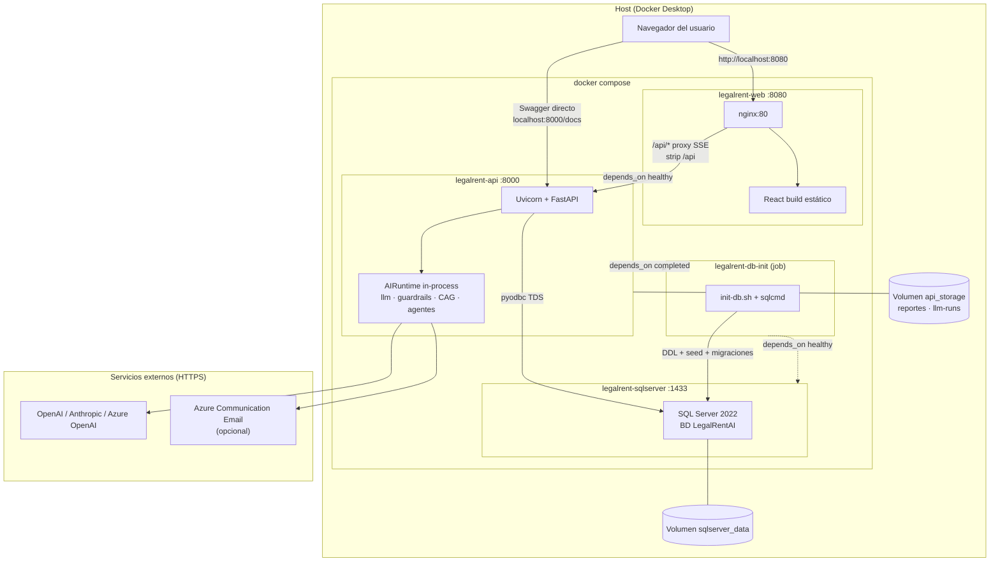

# Arquitectura Docker — Legal Rent AI

Vista de contenedores, red y datos para el stack local definido en [`docker-compose.yml`](../../docker-compose.yml). Guía operativa: [docker.md](./docker.md).

## Diagrama de arquitectura

> **Cómo ver el diagrama:** imagen PNG (abajo), **ASCII** o bloque *Mermaid* (GitHub / VS Code preview / [mermaid.live](https://mermaid.live)).


### Vista ASCII (siempre visible)

```
┌─────────────────────────────────────────────────────────────────────────────┐
│  Navegador                                                                   │
│    http://localhost:8080  ──►  legalrent-web (nginx :80)                     │
│         │                         │  SPA React (dist/)                       │
│         │                         │  /api/* ──proxy SSE──►                   │
│         │                         ▼                                          │
│         │              legalrent-api (Uvicorn :8000)                         │
│         │                         │  FastAPI + AIRuntime (mismo proceso)     │
│         │                         ├── pyodbc ──► legalrent-sqlserver :1433     │
│         │                         │              BD LegalRentAI                │
│         │                         │              ▲                           │
│         │                         │              │ DDL/seed (job único)      │
│         │                         │         legalrent-db-init                │
│         │                         ├── volumen api_storage (reportes, runs)   │
│         └── localhost:8000/docs ──┘                                          │
│                                                                               │
│  sqlserver_data (volumen) ◄── persistencia SQL                               │
│                                                                               │
│  Externo (HTTPS): OpenAI / Anthropic / Azure OpenAI · ACS Email (opcional)   │
└─────────────────────────────────────────────────────────────────────────────┘
```

### Vista Mermaid (renderizada en GitHub / VS Code)



## Servicios

| Servicio Compose | Contenedor | Puerto host | Función |
| ---------------- | ---------- | ----------- | ------- |
| `web` | `legalrent-web` | **8080** → 80 | SPA React; nginx sirve `dist/` y reenvía `/api` al backend |
| `api` | `legalrent-api` | **8000** → 8000 | API REST, pipeline de análisis, chat SSE, agente de firma |
| `sqlserver` | `legalrent-sqlserver` | **1433** → 1433 | Persistencia relacional + binarios de documentos |
| `db-init` | `legalrent-db-init` | — | Job único: scripts en `docs/database/` montados en `/scripts` |

## Flujo de una petición típica

1. El usuario abre **http://localhost:8080** (contenedor `web`).
2. El frontend fue compilado con `VITE_API_URL=/api`; las llamadas van a **mismo origen** `/api/...`.
3. **nginx** (`docker/frontend/default.conf.template`) hace `proxy_pass` a `http://api:8000/` (SSE sin buffering para chat).
4. **FastAPI** en `api` lee/escribe **SQL Server** (`DB_SERVER=sqlserver`, auth `sa` + `MSSQL_SA_PASSWORD`).
5. Análisis y chat invocan **AIRuntime** en el mismo proceso (no hay contenedor IA separado en Docker local).
6. Reportes y trazas LLM se escriben en **`api_storage`** → `/app/backend/storage` dentro del contenedor.

## Imágenes y contexto de build

| Dockerfile | Contenido relevante |
| ---------- | ------------------- |
| [`docker/backend/Dockerfile`](../../docker/backend/Dockerfile) | Python 3.11, ODBC 18, Tesseract, `pip install .`, corpus CAG copiado al image |
| [`docker/frontend/Dockerfile`](../../docker/frontend/Dockerfile) | Node 20 build → nginx Alpine + plantilla de proxy |

Variable **`LEGALRENT_BUILD_CONTEXT`**: permite build desde copia en `%TEMP%` cuando el repo está en Dropbox ([`scripts/docker/docker-up.ps1`](../../scripts/docker/docker-up.ps1)).

## Configuración y secretos

| Origen | Uso |
| ------ | --- |
| `.env.docker` | SQL (`MSSQL_SA_PASSWORD`, `DB_PASSWORD`), `SECRET_KEY`, URLs locales |
| `.env` (opcional, montado en `api`) | Sobrescribe `OPENAI_API_KEY`, ACS, etc. |

El servicio `api` **no** incluye claves en la imagen; se inyectan en runtime.

## Paridad con Azure

| Docker local | Azure LIDR (Container Apps) |
| ------------ | --------------------------- |
| `web` + nginx `/api` | `legalrent-lidr-web` + proxy similar |
| `api` | `legalrent-lidr-api` |
| `sqlserver` | Azure SQL `legalrentlidr-sql` |
| Volúmenes locales | Storage en BD + disco del contenedor / futuro Blob |

Ver [azure-resources.md](./azure-resources.md) y [README raíz — Uso en Azure](../../README.md#uso-en-azure-lidr).

## Referencias

- [docker.md](./docker.md) — arranque, variables, troubleshooting
- [../architecture/ai-runtime-and-litellm.md](../architecture/ai-runtime-and-litellm.md) — capa IA dentro del contenedor `api`
