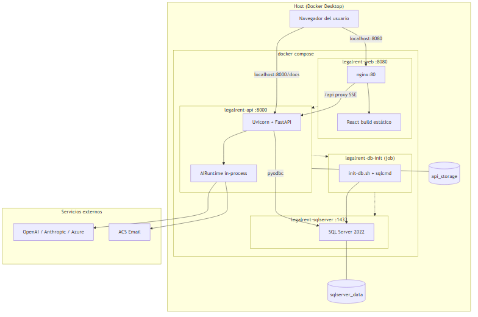
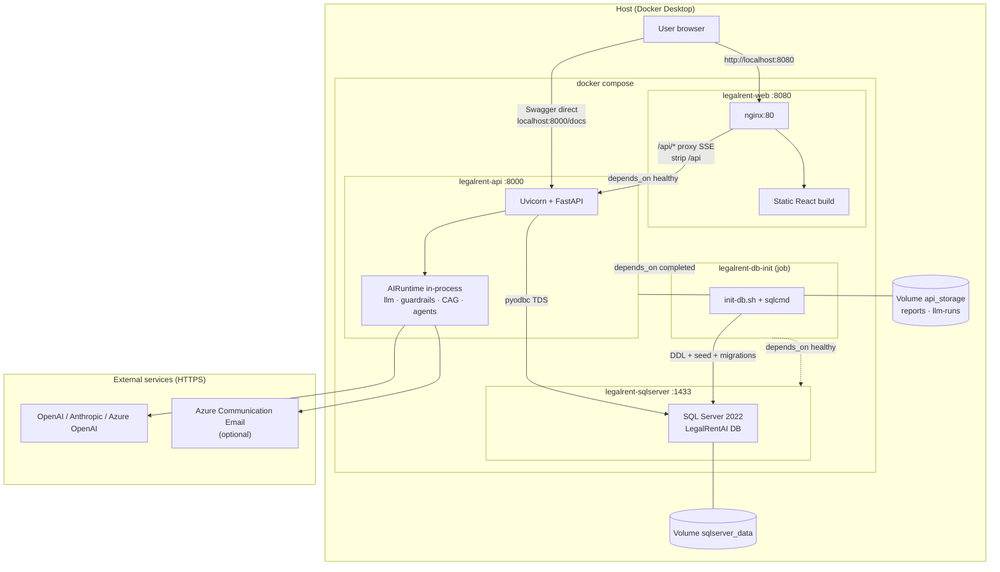

# Docker architecture — Legal Rent AI

Container, network, and data view for the local stack defined in [`docker-compose.yml`](../../docker-compose.yml). Operational guide: [docker.md](./docker.md).

## Architecture diagram

> **How to view the diagram:** PNG image (below), **ASCII**, or *Mermaid* block (GitHub / VS Code preview / [mermaid.live](https://mermaid.live)).



### ASCII view (always visible)

```
┌─────────────────────────────────────────────────────────────────────────────┐
│  Browser                                                                     │
│    http://localhost:8080  ──►  legalrent-web (nginx :80)                     │
│         │                         │  React SPA (dist/)                       │
│         │                         │  /api/* ──proxy SSE──►                   │
│         │                         ▼                                          │
│         │              legalrent-api (Uvicorn :8000)                         │
│         │                         │  FastAPI + AIRuntime (same process)     │
│         │                         ├── pyodbc ──► legalrent-sqlserver :1433     │
│         │                         │              LegalRentAI DB                │
│         │                         │              ▲                           │
│         │                         │              │ DDL/seed (one-off job)      │
│         │                         │         legalrent-db-init                │
│         │                         ├── volume api_storage (reports, runs)   │
│         └── localhost:8000/docs ──┘                                          │
│                                                                               │
│  sqlserver_data (volume) ◄── SQL persistence                               │
│                                                                               │
│  External (HTTPS): OpenAI / Anthropic / Azure OpenAI · ACS Email (optional)   │
└─────────────────────────────────────────────────────────────────────────────┘
```

### Mermaid view (rendered on GitHub / VS Code)



## Services

| Compose service | Container | Host port | Role |
| ---------------- | ---------- | ----------- | ------- |
| `web` | `legalrent-web` | **8080** → 80 | React SPA; nginx serves `dist/` and forwards `/api` to backend |
| `api` | `legalrent-api` | **8000** → 8000 | REST API, analysis pipeline, chat SSE, signing agent |
| `sqlserver` | `legalrent-sqlserver` | **1433** → 1433 | Relational persistence + document binaries |
| `db-init` | `legalrent-db-init` | — | One-off job: scripts in `docs/database/` mounted at `/scripts` |

## Typical request flow

1. User opens **http://localhost:8080** (`web` container).
2. Frontend was built with `VITE_API_URL=/api`; calls go to **same origin** `/api/...`.
3. **nginx** (`docker/frontend/default.conf.template`) `proxy_pass` to `http://api:8000/` (SSE without buffering for chat).
4. **FastAPI** in `api` reads/writes **SQL Server** (`DB_SERVER=sqlserver`, auth `sa` + `MSSQL_SA_PASSWORD`).
5. Analysis and chat invoke **AIRuntime** in the same process (no separate AI container in local Docker).
6. Reports and LLM traces are written to **`api_storage`** → `/app/backend/storage` inside the container.

## Images and build context

| Dockerfile | Relevant content |
| ---------- | ------------------- |
| [`docker/backend/Dockerfile`](../../docker/backend/Dockerfile) | Python 3.11, ODBC 18, Tesseract, `pip install .`, CAG corpus copied into image |
| [`docker/frontend/Dockerfile`](../../docker/frontend/Dockerfile) | Node 20 build → nginx Alpine + proxy template |

**`LEGALRENT_BUILD_CONTEXT`** variable: allows build from a copy in `%TEMP%` when the repo is on Dropbox ([`scripts/docker/docker-up.ps1`](../../scripts/docker/docker-up.ps1)).

## Configuration and secrets

| Source | Use |
| ------ | --- |
| `.env.docker` | SQL (`MSSQL_SA_PASSWORD`, `DB_PASSWORD`), `SECRET_KEY`, local URLs |
| `.env` (optional, mounted on `api`) | Overrides `OPENAI_API_KEY`, ACS, etc. |

The `api` service **does not** embed keys in the image; they are injected at runtime.

## Parity with Azure

| Local Docker | Azure LIDR (Container Apps) |
| ------------ | --------------------------- |
| `web` + nginx `/api` | `legalrent-lidr-web` + similar proxy |
| `api` | `legalrent-lidr-api` |
| `sqlserver` | Azure SQL `legalrentlidr-sql` |
| Local volumes | DB storage + container disk / future Blob |

See [azure-resources.md](./azure-resources.md) and [root README — Azure usage](../../README.md#uso-en-azure-lidr).

## References

- [docker.md](./docker.md) — startup, variables, troubleshooting
- [../architecture/ai-runtime-and-litellm.md](../architecture/ai-runtime-and-litellm.md) — AI layer inside the `api` container
