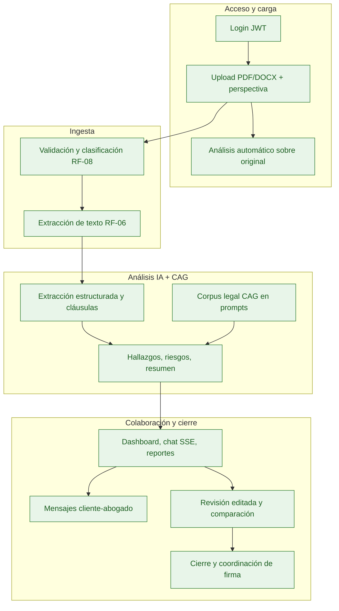

# Sistema de Análisis de Contratos de Arrendamiento en México — MVP

## 1. Propósito del documento

Este documento consolida los **requerimientos funcionales y no funcionales cumplidos** en el MVP **Legal Rent AI**. Sirve como referencia de alcance entregado, alineación con negocio, trazabilidad a pruebas/API y base para mantenimiento evolutivo.

**Estado del documento:** MVP **completado** (septiembre 2026). Todos los ítems listados están implementados en el repositorio (`backend/`, `frontend/`, `docs/`).

---

## 2. Visión del producto

El sistema permite cargar contratos de arrendamiento, extraer información relevante, identificar cláusulas, analizar riesgos jurídicos y contractuales con **corpus legal curado (CAG)**, consultar el contrato en chat, generar reportes y colaborar cliente–abogado hasta el cierre del expediente y la coordinación de firma.

El objetivo es **asistir durante una primera revisión contractual**, manteniendo al abogado como autoridad final.

---

## 3. Alcance del MVP entregado

| Atributo | Valor |
| -------- | ----- |
| Dominio | Arrendamiento inmobiliario en México (prioridad Jalisco) |
| Idioma del dominio legal / documentación | Español |
| Interfaz web | Inglés (API y mensajes técnicos en inglés) |
| Formatos | PDF y DOCX, máx. 25 MB |
| Usuarios | Single-tenant; roles `client` y `lawyer` |
| Stack | Python (FastAPI), React, SQL Server |
| Despliegue | Local, Docker Compose y Azure LIDR (script automatizado) |

---

## 4. Actores y roles

| Actor | Rol API | Responsabilidad entregada |
| ----- | ------- | ------------------------- |
| Cliente | `client` | Carga contratos, análisis, chat, reportes, comparación, notificación al abogado, transiciones `draft` → `in_review` → `approved` |
| Abogado | `lawyer` | Revisión de hallazgos, revisión editada, aprobación de análisis, cierre `terminated`, export de feedback, coordinación de firma |

---

## 5. Flujo principal (completado)

### Ciclo de vida del contrato (RF-56)

Flujo UI: `draft` → `in_review` → `approved` → `terminated`. Tras `terminated` el expediente queda bloqueado. Coordinación post-cierre: agente LangGraph, correo (ACS/SMTP) y página pública `/schedule-signing?token=`.

Detalle de transiciones: [contracts.md](./contracts.md), [api.md](./api.md).

---

## 6. Requerimientos funcionales cumplidos

> Convención: **P0** indispensable · **P1** importante · **P2** human-in-the-loop.

### 6.1 Autenticación y usuarios

| ID | Pri. | Requerimiento |
| -- | ---- | ------------- |
| RF-01 | P0 | Autenticación de usuarios (JWT, login/logout/registro, sesión persistente en SPA). |
| RF-02 | P0 | Roles **Abogado** (`lawyer`) y **Cliente** (`client`) con RBAC en API y UI. |

### 6.2 Carga y gestión de documentos

| ID | Pri. | Requerimiento |
| -- | ---- | ------------- |
| RF-03 | P0 | Carga de contratos PDF y DOCX. |
| RF-04 | P0 | Rechazo de archivos mayores a 25 MB. |
| RF-05 | P0 | Múltiples documentos por contrato (anexos). |
| RF-06 | P0 | Extracción automática de texto PDF/DOCX persistida y consultable. |
| RF-08 | P0 | Clasificación automática: `main_contract`, `annex`, `other`, `lawyer_revision`. |
| RF-52 | P0 | Persistencia de contratos, documentos y análisis (perspectiva × alcance documental). |
| RF-53 | P0 | Soft delete desde UI (sin borrado físico desde el MVP). |
| RF-55 | P1 | Registro de descargas de contratos y reportes (`download_logs`). |
| RF-57 | P1 | Flag `is_signed_version` en documentos adicionales. |

### 6.3 Perspectiva y jurisdicción

| ID | Pri. | Requerimiento |
| -- | ---- | ------------- |
| RF-09 | P0 | Perspectiva de análisis: arrendador, arrendatario, neutral. |
| RF-10 | P0 | Detección de jurisdicción declarada. |
| RF-11 | P0 | Alertas por jurisdicción ausente o inconsistente. |

### 6.4 Extracción estructurada

| ID | Pri. | Requerimiento |
| -- | ---- | ------------- |
| RF-12 | P0 | Identificación de partes (`contract_parties`). |
| RF-13 | P0 | Extracción estructurada de datos contractuales. |
| RF-14 | P0 | Catálogo ampliado de campos (renta, depósito, fechas, inmueble, etc.). |
| RF-15 | P0 | Referencia a página/cláusula en datos extraídos. |
| RF-16 | P0 | Nivel de confianza por campo. |
| RF-17 | P0 | Marcado «requiere revisión» cuando la confianza es insuficiente. |

### 6.5 Cláusulas y reglas

| ID | Pri. | Requerimiento |
| -- | ---- | ------------- |
| RF-18 | P0 | Identificación de cláusulas. |
| RF-19 | P0 | Clasificación por categoría contractual. |
| RF-20 | P0 | Cláusulas relevantes según taxonomía del MVP. |
| RF-21 | P0 | Detección de cláusulas faltantes. |
| RF-22 | P0 | Detección de contradicciones. |
| RF-23 | P0 | Inconsistencias en montos y porcentajes. |
| RF-24 | P0 | Inconsistencias en fechas y vigencias. |
| RF-25 | P0 | Obligaciones principales de arrendador/arrendatario. |
| RF-26 | P0 | Cláusulas desfavorables según perspectiva. |

### 6.6 Riesgos y hallazgos

| ID | Pri. | Requerimiento |
| -- | ---- | ------------- |
| RF-27 | P0 | Severidad bajo / medio / alto por hallazgo. |
| RF-28 | P0 | Riesgo general del contrato. |
| RF-29 | P0 | Explicación de cada riesgo. |
| RF-30 | P0 | Distinción regla legal vs. best practice. |
| RF-31 | P0 | Fundamento normativo y tabla `legal_citations` cuando aplica; corpus CAG en prompts. |
| RF-35 | P0 | Recomendación por hallazgo. |
| RF-36 | P1 | Redacción alternativa sugerida (`suggested_rewording`). |

### 6.7 Corpus jurídico (CAG)

| ID | Pri. | Requerimiento |
| -- | ---- | ------------- |
| RF-32′ | P0 | Grounding con **corpus legal autorizado** (`docs/legal-sources/cag-corpus-v1.md`) inyectado en análisis y chat (`LEGAL_CAG_*`). |
| RF-34′ | P0 | Respuestas de IA apoyadas en fuentes identificables (CAG + evidencia documental + citas persistidas). |

*Nota: RF-32′/RF-34′ sustituyen en el entregable el diseño original de RAG vectorial; el comportamiento de negocio (fundamentación con fuentes curadas) está cubierto.*

### 6.8 Resultado del análisis

| ID | Pri. | Requerimiento |
| -- | ---- | ------------- |
| RF-37 | P0 | Resumen ejecutivo. |
| RF-38 | P0 | Resumen con datos clave, riesgo, hallazgos y recomendaciones. |
| RF-39 | P0 | Hallazgos priorizados por severidad. |
| RF-40 | P0 | Evidencia documental por hallazgo. |

### 6.9 Chat

| ID | Pri. | Requerimiento |
| -- | ---- | ------------- |
| RF-41 | P0 | Chat contextual sobre el contrato. |
| RF-42 | P0 | Contexto: texto del contrato, anexos, resultados de análisis y corpus CAG. |
| RF-43 | P0 | Referencias mostradas en respuestas. |
| RF-44 | P1 | Preguntas sugeridas. |
| RF-45 | P1 | Explicaciones en lenguaje sencillo (multidioma según mensaje del usuario). |

### 6.10 Reportes y notificaciones

| ID | Pri. | Requerimiento |
| -- | ---- | ------------- |
| RF-46 | P0 | Descarga de reporte formal. |
| RF-47 | P0 | Contenido: resumen, datos, riesgos, hallazgos, recomendaciones, citas. |
| RF-48 | P1 | Formato PDF. |
| RF-49 | P1 | Formato JSON estructurado. |
| RF-50 | P0 | Decisión del usuario hacia el abogado (notificación + mensajería en expediente). |
| RF-51 | P0 | Envío de correo al abogado (ACS Email, SMTP o modo dev). |

### 6.11 Estados, comparación y reglas

| ID | Pri. | Requerimiento |
| -- | ---- | ------------- |
| RF-56 | P1 | Estados del contrato y flujo de cierre (`closure_notes`). |
| RF-58 | P1 | Estados del análisis y workflow de revisión abogado. |
| RF-59 | P1 | Comparación entre contratos y original vs. revisión editada. |
| RF-60 | P1 | Detección de cláusulas agregadas/eliminadas. |
| RF-61 | P1 | Cambios en montos, fechas y obligaciones. |
| RF-62 | P1 | Variación de riesgo entre versiones. |
| RF-63 | P1 | Reglas contractuales internas en código (`contract_rules.py`). |

### 6.12 IA, trazabilidad y human-in-the-loop

| ID | Pri. | Requerimiento |
| -- | ---- | ------------- |
| RF-64 | P1 | Trazas técnicas de análisis (`analysis_llm_runs`, `storage/llm-runs/`). |
| RF-65 | P0 | Modelos comerciales externos (OpenAI, Anthropic, Azure OpenAI). |
| RF-66 | P0 | Abstracción de proveedor LLM intercambiable. |
| RF-67 | P1 | Proveedor local (Ollama-compatible). |
| RF-68 | P2 | Veredicto del abogado sobre hallazgos. |
| RF-69 | P2 | Aprobación formal del análisis. |
| RF-70 | P2 | Export de feedback (`/admin/feedback/export`). |

### 6.13 Retención y coordinación de firma (entregables adicionales)

| ID | Pri. | Requerimiento |
| -- | ---- | ------------- |
| RF-54 | P1 | Política de retención (`GET /contracts/retention-policy`) y purga programática (`RetentionService`). |
| RF-71 | P1 | Coordinación post-cierre: agente de firma, correo con enlace tokenizado y API `/public/signing-schedule`. |

---

## 7. Requerimientos no funcionales cumplidos

### 7.1 Rendimiento y capacidad

| ID | Requerimiento |
| -- | ------------- |
| RNF-01 | Soporte a 10 usuarios concurrentes (smoke test). |
| RNF-02 | ~10 análisis diarios en operación demo. |
| RNF-03 | Archivos hasta 25 MB. |
| RNF-04 | Contratos ~20 páginas como escenario habitual. |
| RNF-05 | SLA objetivo ≤ 60 s (`analysis_sla_ms`). |
| RNF-06 | Progreso visible del análisis (polling / async). |

### 7.2 Calidad de IA

| ID | Requerimiento |
| -- | ------------- |
| RNF-08 | No presentar inferencias como hechos confirmados (`requires_review`). |
| RNF-09 | Evidencia y referencias en hallazgos; guardrails de evidencia. |
| RNF-10 | Mensaje explícito cuando falta evidencia. |
| RNF-11 | Grounding vía CAG y guardrails de dominio/injection. |
| RNF-12 | Separación hechos / interpretación / recomendación en UI y reportes. |
| RNF-13 | Confidence en campos y hallazgos críticos. |
| RNF-14 | Prompts versionados (`prompt_id` en runs). |

### 7.3 Seguridad

| ID | Requerimiento |
| -- | ------------- |
| RNF-16 | HTTPS opcional forzado (`force_https`). |
| RNF-17 | Acceso autenticado a rutas protegidas. |
| RNF-18 | RBAC por rol. |
| RNF-19 | Documentos no expuestos públicamente (SQL + token temporal). |
| RNF-20 | Secretos vía `.env` / configuración de despliegue. |
| RNF-21 | Tokens de descarga con TTL. |
| RNF-22 | Validación de tipo, extensión y tamaño de archivo. |

### 7.4 Resiliencia, mantenibilidad, escalabilidad

| ID | Requerimiento |
| -- | ------------- |
| RNF-23 | Errores controlados ante fallo de LLM. |
| RNF-24 | Logging de errores en pipeline documental y análisis. |
| RNF-25 | Fallo de análisis no elimina el contrato cargado. |
| RNF-28 | Backend en Python. |
| RNF-29 | Lógica de negocio separada de proveedores IA. |
| RNF-30 | Abstracción común de LLM. |
| RNF-31 | Prompts y reglas centralizados. |
| RNF-32 | Módulos: documentos, análisis, chat, reportes, notificaciones, CAG. |
| RNF-33 | Repositorio Git. |
| RNF-34 | Configuración por variables de entorno. |
| RNF-35 | Sin límite artificial de contratos almacenados. |
| RNF-36 | Análisis asíncrono opcional (`ANALYSIS_ASYNC`). |
| RNF-37 | Jurisdicción como campo extensible. |
| RNF-38 | Modelo genérico extensible a otros tipos de contrato. |

### 7.5 Usabilidad y trazabilidad

| ID | Requerimiento |
| -- | ------------- |
| RNF-40 | Flujo corto: login → upload → análisis automático. |
| RNF-41 | Hallazgos ordenados por criticidad. |
| RNF-42 | Lenguaje claro en resúmenes y chat. |
| RNF-43 | Términos jurídicos con explicación cuando aplica. |
| RNF-44 | Navegación a evidencia en documento. |
| RNF-45 | Diferenciación visual de severidad. |
| RNF-46 | Trazabilidad de datos extraídos al documento. |
| RNF-47 | Trazabilidad de conclusiones a citas / CAG / evidencia. |
| RNF-48 | Registro de modelo y fecha por análisis. |
| RNF-49 | Registro de descargas. |
| RNF-50 | Investigación post-hoc vía runs y metadata LLM. |

---

## 8. Criterios de aceptación del MVP (escenario completo)

| # | Paso | Resultado |
| - | ---- | --------- |
| 1 | Login con persistencia de sesión | ✅ |
| 2 | Crear expediente (upload) | ✅ |
| 3 | Elegir perspectiva de análisis | ✅ |
| 4 | Cargar PDF/DOCX | ✅ |
| 5 | Adjuntar anexos | ✅ |
| 6 | Extracción de texto | ✅ |
| 7 | Datos principales extraídos | ✅ |
| 8 | Jurisdicción detectada | ✅ |
| 9 | Cláusulas identificadas | ✅ |
| 10 | Grounding con corpus legal CAG | ✅ |
| 11 | Hallazgos generados | ✅ |
| 12 | Nivel de riesgo por hallazgo | ✅ |
| 13 | Evidencia documental | ✅ |
| 14 | Fundamento legal / citas | ✅ |
| 15 | Resumen ejecutivo | ✅ |
| 16 | Chat contextual (SSE) | ✅ |
| 17 | Descarga de reporte PDF/JSON | ✅ |
| 18 | Notificación al abogado | ✅ |
| 19 | Revisión editada y comparación | ✅ |
| 20 | Cierre del expediente y coordinación de firma | ✅ |

**Resultado:** 20 / 20 pasos — **MVP aceptado**.

---

## 9. Métricas de diseño (objetivos cumplidos en entorno objetivo)

| Métrica | Objetivo |
| ------- | -------- |
| Usuarios concurrentes | 10 |
| Análisis diarios | ~10 |
| Tamaño máximo de archivo | 25 MB |
| Contrato típico | ~20 páginas |
| Tiempo objetivo de análisis | ≤ 60 s |
| Idioma dominio / docs | Español |
| Jurisdicción inicial | Jalisco, México |

---

## 10. Resumen ejecutivo

Legal Rent AI entrega un monorepo **frontend + backend** que convierte contratos de arrendamiento en **datos estructurados, hallazgos, riesgos, recomendaciones y evidencias trazables**, con **corpus legal CAG**, chat, reportes, colaboración cliente–abogado, comparación de versiones, cierre de expediente y coordinación de firma.

La arquitectura modular permite cambiar proveedor LLM, desplegar en Docker o Azure LIDR y extender jurisdicciones y tipos contractuales sin rediseño del núcleo.

---

## 11. Referencias

| Documento | Contenido |
| --------- | --------- |
| [api.md](./api.md) | Endpoints REST |
| [authentication.md](./authentication.md) | JWT y roles |
| [contracts.md](./contracts.md) | Upload, estados, retención |
| [database/README.md](./database/README.md) | Modelo SQL |
| [architecture/README.md](./architecture/README.md) | C4 |
| [legal-sources/README.md](./legal-sources/README.md) | Corpus CAG |
| [deployment/docker.md](./deployment/docker.md) | Docker local |
