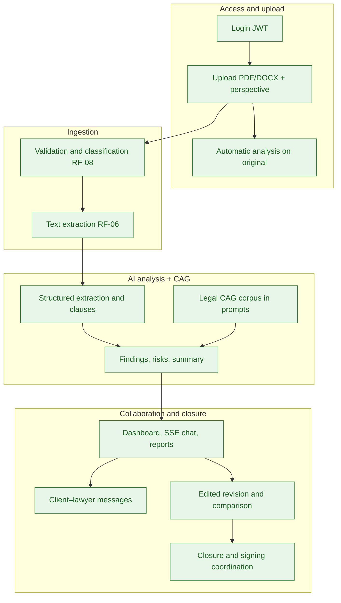

# Mexico Residential Lease Contract Analysis System — MVP

## 1. Document purpose

This document consolidates the **functional and non-functional requirements delivered** in the **Legal Rent AI** MVP. It serves as a reference for delivered scope, business alignment, traceability to tests/API, and a basis for evolutionary maintenance.

**Document status:** MVP **completed** (September 2026). All items listed are implemented in the repository (`backend/`, `frontend/`, `docs/`).

---

## 2. Product vision

The system allows uploading lease contracts, extracting relevant information, identifying clauses, analyzing legal and contractual risks with a **curated legal corpus (CAG)**, querying the contract in chat, generating reports, and collaborating client–lawyer through case closure and signing coordination.

The goal is to **assist during an initial contract review**, keeping the lawyer as the final authority.

---

## 3. Delivered MVP scope

| Attribute | Value |
| -------- | ----- |
| Domain | Residential lease in Mexico (Jalisco priority) |
| Legal domain language / documentation | Spanish (legal domain) / English (product docs) |
| Web UI | English (API and technical messages in English) |
| Formats | PDF and DOCX, max. 25 MB |
| Users | Single-tenant; roles `client` and `lawyer` |
| Stack | Python (FastAPI), React, SQL Server |
| Deployment | Local, Docker Compose, and Azure LIDR (automated script) |

---

## 4. Actors and roles

| Actor | API role | Delivered responsibility |
| ----- | ------- | ------------------------- |
| Client | `client` | Upload contracts, analysis, chat, reports, comparison, notify lawyer, transitions `draft` → `in_review` → `approved` |
| Lawyer | `lawyer` | Review findings, edited revision, analysis approval, `terminated` closure, feedback export, signing coordination |

---

## 5. Main flow (completed)

### Contract lifecycle (RF-56)

UI flow: `draft` → `in_review` → `approved` → `terminated`. After `terminated` the case is locked. Post-closure coordination: LangGraph agent, email (ACS/SMTP), and public page `/schedule-signing?token=`.

Transition detail: [contracts.md](./contracts.md), [api.md](./api.md).

---

## 6. Delivered functional requirements

> Convention: **P0** essential · **P1** important · **P2** human-in-the-loop.

### 6.1 Authentication and users

| ID | Pri. | Requirement |
| -- | ---- | ------------- |
| RF-01 | P0 | User authentication (JWT, login/logout/registration, persistent session in SPA). |
| RF-02 | P0 | **Lawyer** (`lawyer`) and **Client** (`client`) roles with RBAC in API and UI. |

### 6.2 Document upload and management

| ID | Pri. | Requirement |
| -- | ---- | ------------- |
| RF-03 | P0 | Upload of PDF and DOCX contracts. |
| RF-04 | P0 | Reject files larger than 25 MB. |
| RF-05 | P0 | Multiple documents per contract (annexes). |
| RF-06 | P0 | Automatic PDF/DOCX text extraction persisted and queryable. |
| RF-08 | P0 | Automatic classification: `main_contract`, `annex`, `other`, `lawyer_revision`. |
| RF-52 | P0 | Persistence of contracts, documents, and analyses (perspective × document scope). |
| RF-53 | P0 | Soft delete from UI (no physical delete from MVP). |
| RF-55 | P1 | Log contract and report downloads (`download_logs`). |
| RF-57 | P1 | `is_signed_version` flag on additional documents. |

### 6.3 Perspective and jurisdiction

| ID | Pri. | Requirement |
| -- | ---- | ------------- |
| RF-09 | P0 | Analysis perspective: landlord, tenant, neutral. |
| RF-10 | P0 | Detection of declared jurisdiction. |
| RF-11 | P0 | Alerts for missing or inconsistent jurisdiction. |

### 6.4 Structured extraction

| ID | Pri. | Requirement |
| -- | ---- | ------------- |
| RF-12 | P0 | Identification of parties (`contract_parties`). |
| RF-13 | P0 | Structured extraction of contractual data. |
| RF-14 | P0 | Extended field catalog (rent, deposit, dates, property, etc.). |
| RF-15 | P0 | Page/clause reference in extracted data. |
| RF-16 | P0 | Confidence level per field. |
| RF-17 | P0 | «Requires review» marking when confidence is insufficient. |

### 6.5 Clauses and rules

| ID | Pri. | Requirement |
| -- | ---- | ------------- |
| RF-18 | P0 | Clause identification. |
| RF-19 | P0 | Classification by contractual category. |
| RF-20 | P0 | Relevant clauses per MVP taxonomy. |
| RF-21 | P0 | Detection of missing clauses. |
| RF-22 | P0 | Detection of contradictions. |
| RF-23 | P0 | Inconsistencies in amounts and percentages. |
| RF-24 | P0 | Inconsistencies in dates and terms. |
| RF-25 | P0 | Main landlord/tenant obligations. |
| RF-26 | P0 | Unfavorable clauses by perspective. |

### 6.6 Risks and findings

| ID | Pri. | Requirement |
| -- | ---- | ------------- |
| RF-27 | P0 | Low / medium / high severity per finding. |
| RF-28 | P0 | Overall contract risk. |
| RF-29 | P0 | Explanation of each risk. |
| RF-30 | P0 | Distinction legal rule vs. best practice. |
| RF-31 | P0 | Legal basis and `legal_citations` table when applicable; CAG corpus in prompts. |
| RF-35 | P0 | Recommendation per finding. |
| RF-36 | P1 | Suggested alternative wording (`suggested_rewording`). |

### 6.7 Legal corpus (CAG)

| ID | Pri. | Requirement |
| -- | ---- | ------------- |
| RF-32′ | P0 | Grounding with **authorized legal corpus** (`docs/legal-sources/cag-corpus-v1.md`) injected in analysis and chat (`LEGAL_CAG_*`). |
| RF-34′ | P0 | AI responses supported by identifiable sources (CAG + documentary evidence + persisted citations). |

*Note: RF-32′/RF-34′ replace the original vector RAG design in the deliverable; business behavior (grounding with curated sources) is covered.*

### 6.8 Analysis outcome

| ID | Pri. | Requirement |
| -- | ---- | ------------- |
| RF-37 | P0 | Executive summary. |
| RF-38 | P0 | Summary with key data, risk, findings, and recommendations. |
| RF-39 | P0 | Findings prioritized by severity. |
| RF-40 | P0 | Documentary evidence per finding. |

### 6.9 Chat

| ID | Pri. | Requirement |
| -- | ---- | ------------- |
| RF-41 | P0 | Contextual chat about the contract. |
| RF-42 | P0 | Context: contract text, annexes, analysis results, and CAG corpus. |
| RF-43 | P0 | References shown in responses. |
| RF-44 | P1 | Suggested questions. |
| RF-45 | P1 | Plain-language explanations (multilingual per user message). |

### 6.10 Reports and notifications

| ID | Pri. | Requirement |
| -- | ---- | ------------- |
| RF-46 | P0 | Download formal report. |
| RF-47 | P0 | Content: summary, data, risks, findings, recommendations, citations. |
| RF-48 | P1 | PDF format. |
| RF-49 | P1 | Structured JSON format. |
| RF-50 | P0 | User decision toward lawyer (notification + case messaging). |
| RF-51 | P0 | Email to lawyer (ACS Email, SMTP, or dev mode). |

### 6.11 States, comparison, and rules

| ID | Pri. | Requirement |
| -- | ---- | ------------- |
| RF-56 | P1 | Contract states and closure flow (`closure_notes`). |
| RF-58 | P1 | Analysis states and lawyer review workflow. |
| RF-59 | P1 | Comparison between contracts and original vs. edited revision. |
| RF-60 | P1 | Detection of added/removed clauses. |
| RF-61 | P1 | Changes in amounts, dates, and obligations. |
| RF-62 | P1 | Risk variation between versions. |
| RF-63 | P1 | Internal contractual rules in code (`contract_rules.py`). |

### 6.12 AI, traceability, and human-in-the-loop

| ID | Pri. | Requirement |
| -- | ---- | ------------- |
| RF-64 | P1 | Technical analysis traces (`analysis_llm_runs`, `storage/llm-runs/`). |
| RF-65 | P0 | External commercial models (OpenAI, Anthropic, Azure OpenAI). |
| RF-66 | P0 | Interchangeable LLM provider abstraction. |
| RF-67 | P1 | Local provider (Ollama-compatible). |
| RF-68 | P2 | Lawyer verdict on findings. |
| RF-69 | P2 | Formal analysis approval. |
| RF-70 | P2 | Feedback export (`/admin/feedback/export`). |

### 6.13 Retention and signing coordination (additional deliverables)

| ID | Pri. | Requirement |
| -- | ---- | ------------- |
| RF-54 | P1 | Retention policy (`GET /contracts/retention-policy`) and programmatic purge (`RetentionService`). |
| RF-71 | P1 | Post-closure coordination: signing agent, email with tokenized link, and `/public/signing-schedule` API. |

---

## 7. Delivered non-functional requirements

### 7.1 Performance and capacity

| ID | Requirement |
| -- | ------------- |
| RNF-01 | Support 10 concurrent users (smoke test). |
| RNF-02 | ~10 analyses per day in demo operation. |
| RNF-03 | Files up to 25 MB. |
| RNF-04 | ~20-page contracts as typical scenario. |
| RNF-05 | Target SLA ≤ 60 s (`analysis_sla_ms`). |
| RNF-06 | Visible analysis progress (polling / async). |

### 7.2 AI quality

| ID | Requirement |
| -- | ------------- |
| RNF-08 | Do not present inferences as confirmed facts (`requires_review`). |
| RNF-09 | Evidence and references in findings; evidence guardrails. |
| RNF-10 | Explicit message when evidence is missing. |
| RNF-11 | Grounding via CAG and domain/injection guardrails. |
| RNF-12 | Separation facts / interpretation / recommendation in UI and reports. |
| RNF-13 | Confidence on fields and critical findings. |
| RNF-14 | Versioned prompts (`prompt_id` in runs). |

### 7.3 Security

| ID | Requirement |
| -- | ------------- |
| RNF-16 | Optional forced HTTPS (`force_https`). |
| RNF-17 | Authenticated access to protected routes. |
| RNF-18 | RBAC by role. |
| RNF-19 | Documents not exposed publicly (SQL + temporary token). |
| RNF-20 | Secrets via `.env` / deployment configuration. |
| RNF-21 | Download tokens with TTL. |
| RNF-22 | File type, extension, and size validation. |

### 7.4 Resilience, maintainability, scalability

| ID | Requirement |
| -- | ------------- |
| RNF-23 | Controlled errors on LLM failure. |
| RNF-24 | Error logging in document and analysis pipeline. |
| RNF-25 | Analysis failure does not delete uploaded contract. |
| RNF-28 | Python backend. |
| RNF-29 | Business logic separated from AI providers. |
| RNF-30 | Common LLM abstraction. |
| RNF-31 | Centralized prompts and rules. |
| RNF-32 | Modules: documents, analysis, chat, reports, notifications, CAG. |
| RNF-33 | Git repository. |
| RNF-34 | Configuration via environment variables. |
| RNF-35 | No artificial limit on stored contracts. |
| RNF-36 | Optional async analysis (`ANALYSIS_ASYNC`). |
| RNF-37 | Jurisdiction as extensible field. |
| RNF-38 | Generic model extensible to other contract types. |

### 7.5 Usability and traceability

| ID | Requirement |
| -- | ------------- |
| RNF-40 | Short flow: login → upload → automatic analysis. |
| RNF-41 | Findings ordered by criticality. |
| RNF-42 | Clear language in summaries and chat. |
| RNF-43 | Legal terms explained when applicable. |
| RNF-44 | Navigation to evidence in document. |
| RNF-45 | Visual differentiation of severity. |
| RNF-46 | Traceability of extracted data to document. |
| RNF-47 | Traceability of conclusions to citations / CAG / evidence. |
| RNF-48 | Model and date recorded per analysis. |
| RNF-49 | Download logging. |
| RNF-50 | Post-hoc investigation via runs and LLM metadata. |

---

## 8. MVP acceptance criteria (full scenario)

| # | Step | Result |
| - | ---- | --------- |
| 1 | Login with session persistence | ✅ |
| 2 | Create case (upload) | ✅ |
| 3 | Choose analysis perspective | ✅ |
| 4 | Upload PDF/DOCX | ✅ |
| 5 | Attach annexes | ✅ |
| 6 | Text extraction | ✅ |
| 7 | Main data extracted | ✅ |
| 8 | Jurisdiction detected | ✅ |
| 9 | Clauses identified | ✅ |
| 10 | Grounding with legal CAG corpus | ✅ |
| 11 | Findings generated | ✅ |
| 12 | Risk level per finding | ✅ |
| 13 | Documentary evidence | ✅ |
| 14 | Legal basis / citations | ✅ |
| 15 | Executive summary | ✅ |
| 16 | Contextual chat (SSE) | ✅ |
| 17 | PDF/JSON report download | ✅ |
| 18 | Notification to lawyer | ✅ |
| 19 | Edited revision and comparison | ✅ |
| 20 | Case closure and signing coordination | ✅ |

**Result:** 20 / 20 steps — **MVP accepted**.

---

## 9. Design metrics (objectives met in target environment)

| Metric | Target |
| ------- | -------- |
| Concurrent users | 10 |
| Daily analyses | ~10 |
| Maximum file size | 25 MB |
| Typical contract | ~20 pages |
| Target analysis time | ≤ 60 s |
| Domain language / docs | Spanish (legal domain) / English (product docs) |
| Initial jurisdiction | Jalisco, Mexico |

---

## 10. Executive summary

Legal Rent AI delivers a **frontend + backend** monorepo that turns lease contracts into **structured data, findings, risks, recommendations, and traceable evidence**, with **legal CAG corpus**, chat, reports, client–lawyer collaboration, version comparison, case closure, and signing coordination.

The modular architecture allows changing LLM provider, deploying on Docker or Azure LIDR, and extending jurisdictions and contract types without redesigning the core.

---

## 11. References

| Document | Content |
| --------- | --------- |
| [api.md](./api.md) | REST endpoints |
| [authentication.md](./authentication.md) | JWT and roles |
| [contracts.md](./contracts.md) | Upload, states, retention |
| [database/README.md](./database/README.md) | SQL model |
| [architecture/README.md](./architecture/README.md) | C4 |
| [legal-sources/README.md](./legal-sources/README.md) | CAG corpus |
| [deployment/docker.md](./deployment/docker.md) | Local Docker |
